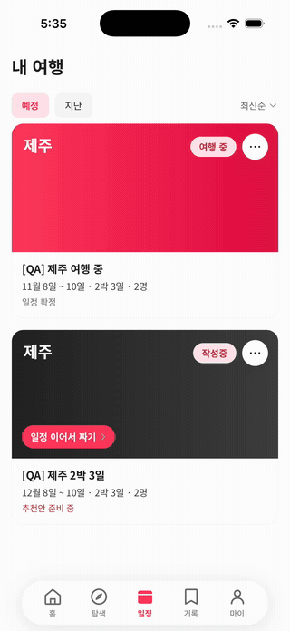

# TripPilot

숙소와 장소를 둘러보고 저장하면 예약 뒤의 일을 앱이 맡는 여행 앱입니다. AI가 일정을 짜고, 여행 중에 계획이 어긋나면 다시 짜 주고, 여행이 끝나면 기록과 회고를 남깁니다. 예약과 결제는 외부 OTA 제휴 링크로 넘깁니다.

**[App Store](https://apps.apple.com/kr/app/id6819041997)** · **[웹](https://app.trippilot.co.kr)**

| 장소 탐색 | 일정 | 여행 중 |
|---|---|---|
|  |  |  |

로컬 백엔드와 테스트 계정으로 iOS 시뮬레이터에서 녹화했습니다. `[QA]`가 붙은 여행은 테스트 데이터이고 장소는 공공 장소 데이터입니다. 일정은 AI 서비스를 띄우지 않은 대체 응답(`AI_SCHEDULE_MODE=fake`)이라, 하루 장소 수와 「거리 정보 없음」 표시가 운영 앱과 다릅니다.

## 담당 범위

팀 프로젝트입니다. `Nyam2C`가 프론트엔드를 맡았고, 백엔드와 AI 서비스는 주로 팀원들이 맡았습니다.

| 항목 (`Nyam2C` / 전체) | 값 |
|---|---|
| 프론트엔드 커밋 | 473 / 530 |
| 지금 프론트엔드 제품 코드 줄 (TS·TSX, 테스트·생성 코드 제외, 줄마다 마지막 수정자) | 105,985 / 114,063 |
| 같은 기준, 테스트 포함 | 353,675 / 382,678 |
| 개발 하네스(`frontend/.claude`) 커밋 | 291 / 312 |
| 다른 패키지 커밋 | backend 28 / 533 · ai 5 / 797 |
| `Nyam2C`의 프론트엔드 첫 커밋 ~ 마지막 커밋 | 2026-07-17 ~ 2026-11-07 |

`develop` 커밋 `0335f278b` 기준입니다. 대부분 스쿼시 머지라 커밋 하나가 PR 하나에 가깝습니다.

## AI 사용 방식

프론트엔드는 Claude Code 에이전트로 개발했습니다. 작업마다 git 워크트리를 따로 열어 에이전트를 병렬로 돌렸고, 명세부터 테스트·구현·적대적 리뷰·검증·기록까지의 순서는 [`frontend/.claude`](frontend/.claude)에 에이전트 정의와 스킬로 정리해 두었습니다.

코드와 테스트 작성, 1차 리뷰, 시뮬레이터 QA의 상당 부분은 에이전트에게 맡겼습니다. 무엇을 만들지 정하고 티켓을 나누는 일, 앱을 직접 써 보며 문제를 찾는 QA, 결과 검수와 출시는 사람이 했습니다. 그래서 위 줄 수는 `Nyam2C` 계정으로 들어간 코드의 양이지 손으로 친 양이 아닙니다.

## 로컬 실행

Docker, Node 22, pnpm 11, Xcode, CocoaPods가 필요합니다.

```bash
# 1. 백엔드·DB (리포 루트, 이미지를 직접 빌드한다)
docker compose --profile backend up -d --build backend
# 2. 의존성·환경 변수
cd frontend && pnpm install && cp .env.example .env
# 3. iOS 앱 빌드·실행 (pnpm 구조에서는 Sentry 빌드 단계가 CLI를 못 찾아 경로를 직접 준다)
export LANG=en_US.UTF-8 SENTRY_DISABLE_AUTO_UPLOAD=true
export SENTRY_CLI_EXECUTABLE="$(echo "$PWD"/node_modules/.pnpm/@sentry+cli@*/node_modules/@sentry/cli/bin/sentry-cli)"
pnpm expo prebuild -p ios && pnpm expo run:ios
```

지도와 소셜 로그인 키는 각 콘솔에서 발급받아 `frontend/.env`에 넣고(`.env.example` 참고), 서버 쪽 소셜 키는 리포 루트 `.env`에 넣습니다(루트 `.env.example` 참고). 1단계를 이미 돌렸다면 `docker compose --profile backend up -d backend`를 다시 해야 반영됩니다. 키가 없으면 로그인할 수 없으니, 앱을 보기만 하려면 위 링크가 빠릅니다.

## 모노레포 구조

설계 문서(주로 한국어)도 같은 리포에 있으며, 문서와 코드가 어긋나면 **코드가 정본**이다.

| 디렉토리 | 역할 |
|---|---|
| `docs/` | 팀 프로세스 문서 — 컨벤션 (`docs/conventions/`: 브랜치·커밋·PR) + 도구 가이드 (`docs/guides/`: 지라·슬랙) |
| `backend/` | 백엔드 (Spring Boot + Kotlin 모듈러 모놀리스). 설계 문서 `backend/docs/design/` |
| `frontend/` | 프론트엔드 (React Native + Expo). 설계·IO 문서 `frontend/docs/` |
| `ai/` | AI 서비스 (FastAPI) + 설계 문서 (일정/Plan-B/회고 아키텍처·프롬프트·솔버·테스트) |
| `aidlc/` | 팀원 소유 AWS AI-DLC(Amazon Q) 워크스페이스. **기획 정본** = `aidlc-docs/inception/` (요구사항·스토리·유닛 U0–U9), **유닛별 설계** = `aidlc-docs/construction/`. 조율 없이 수정 금지 |

- 온보딩: `CLAUDE.md` → `aidlc/aidlc-docs/inception/`
- 화면 명세는 **Figma가 유일한 정본** — 리포에 사본을 두지 않는다(와이어프레임 PNG도 리포 외부). 밴드 맵·파일 키는 `frontend/.claude/skills/spec-perception/reference/figma-structure.md`
- 문서 충돌 시: 제품 요구사항·스토리·유닛은 `aidlc/aidlc-docs/inception/`, 패키지 아키텍처·구현 결정은 해당 패키지 정본(`frontend/README.md` · `backend/docs/design/` · `ai/`)이 우선
