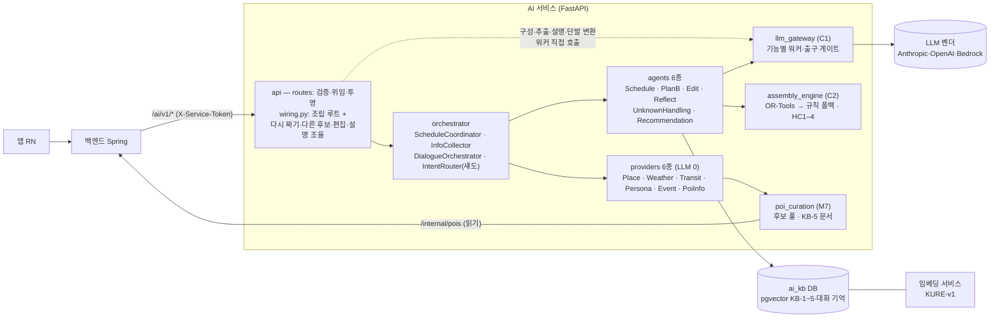
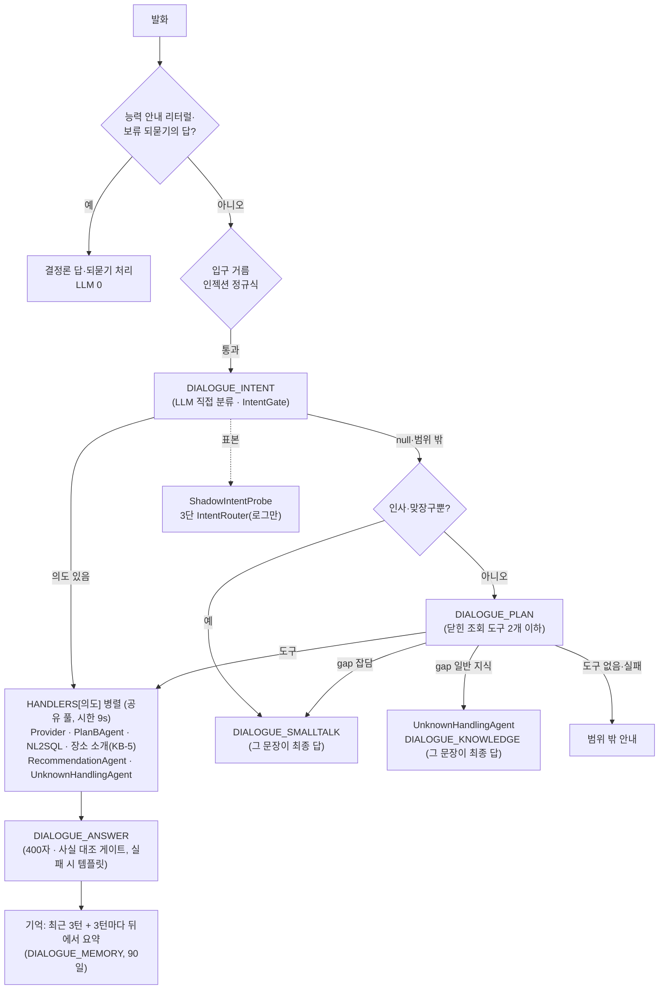

# TripPilot AI 아키텍처

> **작성 2026-11-02 · 기준 develop `01705f6ec`** — AI 서비스(`ai/`) 아키텍처의 **단일 정본**이다.
> 흩어져 있던 개요 문서(README·`claude.md` 개요부·`ai-architecture`·`agent-structure-v2`·`agent-redesign`·`components` 등, §13)는
> 이 문서로 대체됐고 이력·세부 참고용으로만 남는다.
> **사실이 어긋나면 코드가 이기고, 이 문서를 고친다.** 와이어(HTTP 계약)의 정본은 [`docs/openapi.json`](docs/openapi.json) 이다.
> 파일 경로는 재배치가 진행 중이라(2026-11 `orchestrator`·`domain`·`llm_gateway` 하위폴더) 되도록 **패키지와 클래스 이름**으로 적는다.

---

## 1. 한눈에

AI 는 **상태를 갖지 않는 판단·조립 서비스**다. 앱은 AI 를 직접 부르지 않는다 — 백엔드(Spring)만 `/ai/v1/*` 를 부르고,
일정·여행은 요청에 스냅샷으로 실려 온다. 장소(POI)의 정본은 백엔드 DB 이고, AI 는 읽기와 등록 **제안**만 한다.



## 2. 지켜야 하는 것

| 원칙 | 내용 |
|---|---|
| **INV-1** 닫힌 후보 | LLM 은 닫힌 후보 풀 안에서만 고른다. 웹에서 찾은 장소도 수집 게이트를 거쳐 백엔드에 등록돼야 후보가 된다. 게이트가 출력의 후보 id 를 풀과 대조한다 |
| **INV-2** 시각은 조립값 | 사용자에게 보이는 시각·순서는 조립 엔진이 검증한 값뿐이다. LLM·라우터는 **제안**만 한다 |
| **INV-3** 소요시간 금지 | 소요시간은 어디에도 보이지 않는다 — 거리만. DTO 에 `duration` 칸이 없고, 출구 게이트가 시간 표현을 막는다 |
| **INV-4** 결정론 폴백 | AI 가 실패하면 결정론으로 물러선다. 조용한 실패는 금지 — 응답의 `is_fallback`·`fallback_level`·`degradations`·`scoring_mode`·`degraded` 로 드러낸다 |
| 판단과 실행 가능성의 분리 | 해석·선호 점수·설명·구성 같은 **판단**은 LLM(게이트웨이)이, 시각·순서·이동·하드 제약 같은 **실행 가능성**은 조립 엔진이 갖는다 |
| 무상태 | AI 는 일정·여행을 저장하지 않는다(요청 스냅샷). AI 자체 DB(`ai_kb`)에는 지식 KB·대화 기억·장소 사실 캐시만 있다 |
| 시한은 오류가 아니다 | 시한(`request_meta.deadline_ms`)을 넘기면 200 + 폴백 결과다(조립 최후 단계가 시한과 무관하게 해를 낸다). 백엔드는 200 이면 다시 폴백하지 않는다(이중 폴백 금지). 프로세스가 멈춘 비정상 상황만 시한 + 5초 백스톱이 504 를 낸다 |

## 3. 층과 패키지

`ai/src/trippilot/` 아래 열 개 패키지. 안쪽(위)일수록 순수하다.

| 패키지 | 맡는 일 | 대표 |
|---|---|---|
| `domain` | 표준 라이브러리만 쓰는 타입. 불변식을 타입으로 강제(`__post_init__`) | `LlmFeature`·`CandidatePool`, `Intent`·`ROUTING_TABLE`, `ProviderKind`·`ProviderStatus`, `KbKind`, `AgentTask`·`AgentResult` |
| `ports` | Protocol 계약(LLM·임베딩·벡터·기억·POI DB·이동·날씨·행사·휴일…) | `LlmPort`, `EmbeddingPort`, `VectorStorePort`, `PoiDbPort` |
| `assembly_engine` (C2) | 결정론 조립과 HC1–4 검증·수리 — 실행 가능성의 주인 | `HybridAssemblyFacade`(solve·regenerate·validate·repair), `OrToolsAssembler`, `RuleFallbackAssembler`, `TravelEstimator`·`WalkFirst`, `plan_parking` |
| `llm_gateway` (C1) | LLM 으로 가는 **유일한** 길: 라우팅 → 렌더 → 호출 → 파싱 → 출구 게이트 → 타입 결과 또는 폴백 신호 | `GatewayFacade`·`TierRouter`, `PromptRegistry`(`ai/prompts/*.yaml`), 기능별 워커·게이트, 벤더·임베딩 어댑터 |
| `poi_curation` (M7) | 백엔드 POI 정본을 읽어 닫힌 후보 풀을 만든다. KB-5 문서 조립, 오프라인 수집 파이프라인(수집 게이트 → 백엔드 등록 제안) | `CandidatePoolBuilder`, `BackendPoiDb`, `place_docs`, `sourcing/*` |
| `providers` | 정보 수집, **LLM 0회**. 실패는 예외가 아니라 상태값 | §7 |
| `agents` | 과업 단위. 워커와 조립 엔진을 감싸 `run(<Task>)` 하나로 노출 | §6 |
| `orchestrator` | 요청·턴 조율, 정보 수집, 위임 | §7 |
| `api` | FastAPI 경계. `routes` 는 검증·위임·투영만 한다. `wiring.py` 는 전부를 조립하는 루트이면서, `WiredItineraryOrchestrator` 가 **다시 짜기·다른 후보·편집·검증·설명을 직접 조율**하고 구성·추출·지시 번역·설명 워커를 에이전트 없이 부른다(`orchestrator` 패키지를 거치는 것은 생성과 도우미뿐) | `create_app`, `routes`, `WiredItineraryOrchestrator`, `schemas`(`extra=forbid`), `errors`, `middleware`(서비스 토큰·본문 상한·속도 제한·시한 백스톱) |
| `background` | 오프라인 배치용 도우미(네이버 검색·카카오 지오코더·행사 저장소). 런타임은 저장소를 읽기만 | `JsonEventStore` |

**하위 폴더**: 파일이 몰렸던 세 패키지만 기능 묶음으로 나눴다(2026-11-02, import 경로만 바뀜). 층·의존 규칙은 그대로다.

- `domain/` — 공용 타입(`common`·`context`·`edit`·`persona` 등)은 바로 아래에 둔다. 묶음은 `dialogue`(`Intent`·위임·계획 도구), `itinerary`(해·문제·이동), `llm`(`LlmFeature`·`CandidatePool`·프롬프트 참조·평가), `poi`(`Poi`·지역 중심·테마 태그)다.
- `orchestrator/` — `intent`(의도 라우터·질문뱅크), `dialogue`(`DialogueOrchestrator`·핸들러·계획·기억·장소 SQL), `schedule`(생성 조율·정보 수집).
- `llm_gateway/{gates,workers}/` — 같은 기능의 게이트와 워커는 같은 이름 폴더에 있다. 묶음은 `content`(편집 번역·리마인드·공유 카드·회고 문구), `dialogue`, `preference`(점수·번호 고르기), `replan`(대안 고르기·설명·지시 번역)이다.

**의존 규칙**은 `ai/tests/test_architecture.py` 가 빌드에서 강제한다. 요지:

- 안쪽 층(`domain`·`ports`·`llm_gateway`·`assembly_engine`·`poi_curation`)은 바깥(`agents`·`orchestrator`·`providers`·`background`)을 import 하지 않는다(L-1).
- 에이전트끼리 import 금지(L-2), 에이전트는 `LlmPort` 를 직접 쓰지 않고 게이트웨이로만(L-3), Provider·오케스트레이터 import 금지(L-4·L-6).
- Provider 는 LLM 을 쓰지 않는다(L-5). 게이트웨이는 조립·큐레이션을 import 하지 않는다(BR-U4-09).
- `src/` 안에서 벤더 SDK(`anthropic`·`openai`)는 `adapters/` 안에서만, `ortools` 는 조립 엔진 안에서만, `yaml` 은 프롬프트 레지스트리에서만(조립 진입점 `ai/main.py` 는 예외).
- KB 컬렉션 이름은 `collection_for()` 로만 만든다(임베딩 모델 이름이 붙는다).

## 4. 백엔드 ↔ AI 경계

와이어 정본은 [`docs/openapi.json`](docs/openapi.json)(AI CI 가 "실행 앱 스키마 == 커밋된 계약"을 강제). 백엔드가 **실제로 부르는 경로**의 정본은 백엔드 어댑터 상수다.

| 묶음 | 경로 (모두 POST, 표시 외) | 백엔드 호출 상수 |
|---|---|---|
| 일정 | `/ai/v1/itinerary/{generate, validate, repair, explanations, edit}` | `HttpScheduleAgentAdapter.CALLED_PATHS` |
| Plan-B | `/ai/v1/planb/{replan, alternatives}` | 같은 상수 |
| Plan-B 기회 | `/ai/v1/planb/opportunities` | `HttpOpportunityAdapter.OPPORTUNITY_PATHS` |
| 회고 | `/ai/v1/reflection/{generate, share-card}` | `AiReflectionPaths.CALLED` |
| 회고 넛지 | `/ai/v1/reflection/nudge` | **호출처 없음**(백엔드가 일부러 제외) |
| 알림 문구 | `/ai/v1/notification/copies` | `HttpReminderCopyAdapter.COPIES_PATH` |
| 도우미 | `/ai/v1/dialogue/interpret`, `GET`·`DELETE /ai/v1/dialogue/memory` | `HttpDialogueInterpreter.DIALOGUE_PATHS` |
| 상태 | `GET /`, `GET /health` | 프로브 |

- **AI → 백엔드**: `BackendPoiDb` 가 `GET /internal/pois`(반경)·`POST /internal/pois/batch-get`(id 묶음)으로 POI 를 읽는다. 도우미의 NL2SQL 은 백엔드 DB 의 읽기 전용 뷰 `app.poi_public` 을 `ai_user`(2초 제한)로 읽는다.
- **배포 시점**(서비스 아님): AI 이미지의 공유본을 `ingest_pois.py` Job 이 `POST /internal/pois/proposals`(·`close-missing`)로 붓는다(§10).
- **오류 매핑**: 422 검증·불변식 · 409 조립 충돌 · 403 권한 · 503 미배선(`ORCHESTRATOR_NOT_WIRED`) · 500 내부(백엔드 POI 조회 인증 실패 포함). 미들웨어: 401 서비스 토큰 · 413 본문 상한 · 429 속도 제한 · 504 시한 백스톱(`deadline_ms` + 5초). 정상적인 시한 초과는 200 + 폴백.

## 5. 요청 흐름

모든 경로는 `routes` → `WiredItineraryOrchestrator`(조립 루트) 메서드로 간다.

**일정 생성** `/itinerary/generate`
1. 여러 지역 여행은 앵커가 같은 날 묶음으로 나누고 시한을 나눠 준다.
2. `ScheduleCoordinator` — 소유 검증(실패 시 닫힘) → 시한 배분 → `InfoCollector` 가 PLACE·WEATHER·PERSONA·EVENT 를 병렬 수집(풀이 비면 반경 한 번 넓힘). 구를 고른 날은 구 안 후보를 먼저 쓴다(`anchors[].region_codes`).
3. `ScheduleAgent.run` — 선호 점수(`PREFERENCE_SCORING`, 후보 번호화·묶음 병렬, 실패 시 규칙 점수) → 강등(지시·Plan-B 랭크·거절 이력·같은 계열·지도 실재 확인) → 문제 구성 → `solve`(OR-Tools → 규칙 폴백) → (요청 시) 설명 → 슬롯별 차선책(결정론) → 차선책 이유 문장(`ALTERNATIVE_EXPLANATION`).
4. 화면 거리(실경로, 짧은 예산), 꼭 갈 곳 미배치 판정, 응답 봉투.

**다시 짜기** `/planb/replan` — 조율자는 `WiredItineraryOrchestrator` 다.
1. 자유 발화 추출(`REPLAN_REQUEST_EXTRACTION`)과 재계획 지시 해석(KB-4 매칭 → `REPLAN_DIRECTIVE_TRANSLATION`)을 배경으로 먼저 띄운다. 추출이 장소 이름을 내면 이름 대조용 등록 POI 조회(반경 50km)도 곧바로 배경으로 띄운다.
2. `InfoCollector`(REPLAN) — 지시 해석은 풀 확대 판정 직전에 받는다. 잠금 블록(고정·저녁·진행 중·지난 칸), 추출 주장 대조(이름은 받은 후보 풀에서 정확 일치로 먼저 찾고, 없을 때만 그 50km 조회를 기다린다).
3. `PlanBAgent` 규칙 랭킹 → **구성 LLM 이 남은 하루를 고른다**(`REPLAN_COMPOSITION`, 번호 선택 게이트, KB-5 장소 지식) → `ScheduleAgent` 로 solve → 1회 수리.

**다른 후보** `/planb/alternatives` — `InfoCollector` → `PlanBAgent.run`(KB-3 상황·KB-2 취향·KB-5 장소 검색 → `ALTERNATIVE_SELECTION`, 실패 시 규칙 랭킹) → 닫힌 집합 재확인. 응답에 시각이 없다(배치는 백엔드의 repair 몫).

**편집** `/itinerary/edit` — `InfoCollector`(PLACE) → `EditAgent.run`: 날마다 동네로 다시 짜기·사이 넣기(LLM 0)를 먼저 보고, 아니면 `EDIT_TRANSLATION` → 명령 검증 → 확인 게이트 → 결정론 재타이밍 → 조립 검증.

**검증·수리** `/itinerary/{validate, repair}` — 요청 스냅샷을 재구성해 HC1–4 검사 또는 최소 변경(시각만 밀기) 수리. LLM 0회.

**설명** `/itinerary/explanations` — 날마다 `EXPLANATION`(병렬), 남은 예산으로 차선책 설명.

**도우미** `/dialogue/interpret` (스위치 `TRIPPILOT_DIALOGUE_ORCHESTRATOR`, 코드 기본 off · 개발·운영은 on)



- 일정 고치기(`EDIT_SCHEDULE`)는 답 대신 `FRAME` 을 돌려 백엔드 제안 경로로 넘긴다.
- 장소 탐색은 반경 풀(규칙 정렬)과 NL2SQL 이 나란히 돌고 SQL 행이 있으면 그것이 답이다(추천은 반경이 먼저, BR-AO-30) — 묘사형 말("비 오는 날 실내")이면 열린 검색(KB-5 문서 순위, `TRIPPILOT_KB5_OPEN_SEARCH`, 기본 off)이 반경 순서를 섞지만, 그 순서는 반경 결과(SQL 0건·실패·추천·일정 근처)에만 쓰인다(BR-AO-27 · BR-AO-36).
- 스위치가 off 면 종전 `DialogueInterpreter` → `IntentRouter`(질문뱅크 임베딩 → 바꿔 말하기 투표 → LLM)가 서비스 경로다. 스위치가 on 이어도 질문뱅크 1차 매칭은 보류 되묻기의 답이 "새 요청인가"를 LLM 없이 가를 때 쓰인다 — 그래서 운영에도 뱅크 색인이 필요하다.
- 개발 서버에는 입구 인젝션 소형 분류기가 그림자로 붙어 판정만 로그에 남긴다(응답 무영향).

**회고** `/reflection/generate` — `ReflectAgent.run`: `REFLECTION_TEMPLATE`(최대 3회, 예산 공유) → 결정론 마무리(자리표시자 채움), 실패 시 고정 템플릿. 사진은 자리만 내고 앱이 기기 사진으로 채운다(사진은 서버로 오지 않는다 → vision 갈래는 돌지 않는다).

**단발 변환(에이전트 없이 워커 직행)** — 판단이 없는 한 번짜리 변환은 에이전트를 만들지 않는 것이 정식 패턴이다(u6-reflect FD §2.1): 공유 카드 문구(`SHARE_CARD_COPY`), 넛지(`REFLECTION_NUDGE`), 알림 문구(`REMINDER_COPY`, 파인튜닝 학생 모델).

**Plan-B 기회** `/planb/opportunities` — 행사(EVENT) + 슬롯별 1km 안 POI → 결정론 판정. LLM 0회.

## 6. 에이전트 6종

정본: `agents/__init__.py`. **에이전트 = 워커와 조립 엔진을 감싸 `run(<Task>)` 진입점 하나를 갖는 과업 단위**다. LLM 은 게이트웨이로만 쓰고(L-3), 판단이 없으면 LLM 을 안 써도 된다(RecommendationAgent).

| 에이전트 | 진입점 | 감싸는 것 · 쓰는 곳 |
|---|---|---|
| `ScheduleAgent` | `run(ScheduleTask) -> GenerationOutcome` | 선호 점수·설명·차선책 설명 워커, 조립 — 생성·다시 짜기·편집의 재조립 |
| `PlanBAgent` | `run(PlanBRagRequest)` | KB-2·3·5 검색 + `ALTERNATIVE_SELECTION` — 다른 후보, 다시 짜기의 규칙 랭킹, 도우미 |
| `EditAgent` | `run(EditTask) -> EditOutcome` | `EDIT_TRANSLATION`, 조립 검증 — 편집 |
| `ReflectAgent` | `run(ReflectTask) -> ReflectionTemplate` | `REFLECTION_TEMPLATE` — 회고 |
| `UnknownHandlingAgent` | `run(UnknownTask \| KnowledgeTask) -> UnknownOutcome` | `PLACE_FACT_LOOKUP`(먼저 답하고 뒤에서 웹 확인, 사실 캐시)·`DIALOGUE_KNOWLEDGE` — 도우미 |
| `RecommendationAgent` | `run(RecommendTask) -> RecommendOutcome` | LLM 0 — 도우미의 장소·지역 추천 고르기 |

`Agent.handle(AgentTask) -> AgentResult` 봉투는 **여섯 모두 미구현**이다(설계 목표, §12). 에이전트 재료는 오케스트레이터가 모아 Task 로 넘긴다 — 에이전트는 Provider 를 부르지 않는다(L-4).

## 7. 오케스트레이터와 Provider

| 구성 | 맡는 일 |
|---|---|
| `ScheduleCoordinator` | 일정 생성만 조율한다(의도 파악 없음) — 소유 검증, 시한 배분, 정보 수집, 재료 소화 후 `ScheduleAgent` 위임 |
| `InfoCollector` | `INFO_REQUIREMENTS` 표(의도 → 필요한 Provider)대로 병렬 수집. 표에 없는 의도는 오류, 등록 안 된 Provider 는 건너뜀 |
| `DialogueOrchestrator` | 도우미 턴 전체(§5 그림). 분류·계획·답변·기억에 LLM 을 쓴다 — "오케스트레이터는 판단 최소" 원칙의 명시적 예외(10-17 사용자 결정) |
| `IntentRouter` | 3단 질문뱅크 라우터. 도우미 스위치 off 일 때 서비스 경로, on 이면 `ShadowIntentProbe` 로 표본만 돌려 일치율을 로그로 잰다(1차 뱅크 매칭은 on 에서도 보류 되묻기 판정에 쓰인다) |

**Provider 6종**(LLM 0, 결과는 `InfoPacket` + `ProviderStatus`: `OK`·`LOW`·`NO_CANDIDATES`·`WEATHER_UNKNOWN`·`COLD_START`·`UNAVAILABLE`)

| Provider | 출처 |
|---|---|
| Place | `CandidatePoolBuilder`(백엔드 POI → 6단 필터 → 닫힌 풀, 반경 한 번 넓힘) |
| Weather | 기상청(키가 있을 때만 등록) |
| Transit | 실경로 포트(TMAP·ODsay → 직선 추정) |
| Persona | 요청에 실린 취향 + 정적 기본값 |
| Event | 행사 저장소(오프라인 수집본 — 저장소 경로가 설정됐을 때만 등록) |
| PoiInfo | POI 상세·입장료 표 |

생성·다시 짜기·다른 후보·편집에서는 `InfoCollector` 만 Provider 를 부른다. 도우미 핸들러는 Provider 를 직접 부른다.

## 8. LLM 게이트웨이

- **기능은 닫힌 집합** `LlmFeature` 다(정본 `domain` 의 `LlmFeature`). 묶음: 일정(선호 점수·설명·차선책 설명·대안 선택), 편집·재계획(편집 번역·지시 번역·구성·요청 추출), 도우미(분류·계획·SQL·답변·잡담·지식·기억·장소 사실 확인), 회고·알림(템플릿·사진 템플릿·넛지·공유 카드·알림 문구·사진 하이라이트), 수집·의도(행사 추출·장소 추출·질문뱅크 증강·의도·바꿔 말하기·사유 해석).
- 기능마다 대개 워커·출구 게이트·프롬프트 판(`ai/prompts/*.yaml`, 판 번호 관리)이 한 벌이다. 예외: 게이트를 함께 쓰는 쌍(설명·차선책 설명, 의도·도우미 분류, 답변·잡담), 워커 없는 기능(의도·바꿔 말하기·질문뱅크 증강 — 라우터·스크립트가 직접), 이름만 있는 기능(`REASON_INTERPRETATION`).
- **모델 배정의 정본은 배포 환경변수** `TRIPPILOT_LLM_FEATURE_MODELS`(`기능=모델,…`, 모르는 기능 이름은 기동 실패)다. 없으면 티어 기본 모델, 벤더는 `TRIPPILOT_LLM_PROVIDER`(openai·anthropic·mixed). `local*` 모델은 Bedrock Custom Model Import(알림 문구 학생 모델) 또는 로컬 서버로 간다. 모델 이름은 자주 바뀌므로 문서에 박지 않는다.
- 기능 일부(도우미 계획·SQL·잡담·지식·장소 사실 확인)는 **모델이 배정돼야 켜진다**.
- **게이트**: 닫힌 집합 대조(INV-1, 장소 사실 확인은 출처 URL 이 닫힌 집합), 시간 표현 차단(INV-3), 인젝션·연락처 패턴, 길이·형식.
- **재시도**: 벤더 SDK 재시도는 끈다. 시한은 `DeadlineTransport` 가 지킨다. 기능별 재시도 모델(`TRIPPILOT_LLM_RETRY_MODELS`)로 시간 초과 때 한 번, 장소 사실 확인은 벤더 오류에도 다른 벤더로 넘긴다. 그 밖은 폴백 신호를 돌려주고 **폴백 실행은 호출자 몫**이다.

## 9. 조립 엔진

- **배선된 단계는 둘**: `OrToolsAssembler`(CP-SAT, 결정론 한도·고정 시드, 상위 후보 사전 거름) → `RuleFallbackAssembler`(늘 해를 낸다). LLM 2차 단계(`LlmAssembler`)는 코드만 있고 **미배선**이다.
- **하드 제약**: HC1 영업시간(휴무일·시간 밖, 공휴일 휴무는 `HOLIDAY_CLOSURE_MODE=on` 일 때만 — 코드 기본 off; 정보 없음은 통과) · HC2 이동 가능(앞 끝 + 이동 ≤ 다음 시작) · HC3 고정 블록 시각 유지(사용자가 편집으로 바꾼 고정 시각은 새 고정값 — INV-U3-03 2026-10-30 개정) · HC4 하루 창 안.
- **이동 추정** `TravelEstimator`: 직선 × 우회 계수, 수단별 속도. 대중교통 여행도 가까우면(0.7km 이하) 걷고, 도보 여행도 멀면(1.5km 이상) 대중교통. 자차는 짜기 전에 장소를 **주차 거점**으로 묶어(`plan_parking`) 같은 거점은 걷고, 거점 사이는 운전 + 주차 시간. **조립(솔버)은 늘 이 추정을 쓴다** — TMAP·ODsay 실경로는 화면 거리와 Transit Provider 용이고, 화면도 같은 수단 판정(`WalkFirst`)을 쓴다.

## 10. 데이터

**POI 흐름**: 일일 수집(TourAPI 등, 수집 게이트) → 공유본 `ai/data/collected_pois.json`(봇 PR 로 develop) → AI 이미지에 실림 → 배포 뒤 `load-pois` Job 이 백엔드에 등록 제안 → 백엔드가 POI 정본을 갖고, AI 는 `/internal/pois` 로 읽는다. 공유본만 고치고 배포하지 않으면 효과가 없다.

**지식 KB** — `ai_kb` 데이터베이스의 pgvector 표 `kb_vectors`, KB 마다 컬렉션 하나(이름에 임베딩 모델이 붙는다). 임베딩은 `nlpai-lab/KURE-v1`(1024차원), 별도 임베딩 서비스(`POST /embed`).

| KB | 내용 | 실제 상태 |
|---|---|---|
| KB-1 일정 | 현재 일정 | 검색하지 않는다 — 일정은 요청 스냅샷으로 온다 |
| KB-2 취향 | 취향 패턴 | 검색은 하나 적재 시드가 없다 |
| KB-3 상황 | 상황별 조언(비·피로…) | 시드 YAML, 상위 4건 |
| KB-4 지시 | 재계획 칩·자유 발화 사전 | 시드 YAML |
| KB-5 장소 | 장소 지식(위키 본문·관광공사 개요 조각) | 적재·증분 진행. 후보 전원이 아니라 숏리스트 후보만 검색. 대체 문서(장소 카드·웹 확인 사실)는 기본 켜짐 — 2026-11-03, `TRIPPILOT_KB5_FALLBACK=off` 로 끈다. 도우미 장소 탐색·추천의 열린 검색(반경 후보 안 조각의 BM25+임베딩 순위를 규칙 순서에 RRF 로 섞는다, BR-AO-36)은 기본 꺼짐 — `TRIPPILOT_KB5_OPEN_SEARCH=on` 으로 켠다. 같은 스위치가 PlanB 다시 짜기 후보 순위(구성 LLM 이 받는 앞 20)에도 문서 순위를 섞는다(`rag.fuse_rule_ranking`, U4 FD 2026-11-04) |

**그 밖의 AI DB 표**: `dialogue_memory`·`dialogue_memory_vectors`(대화 기억, 90일), `place_fact_cache`(웹 확인 사실 캐시). **질문뱅크**는 미리 계산한 벡터로 기동 때 메모리에 색인한다(DB 적재 없음).

## 11. 배치와 배포

- **GitHub Actions 배치**: POI 수집(매일), 행사 수집(매일, 네이버 검색 → `EVENT_EXTRACTION`), 관광공사 개요 수집(하루 두 번, KB-5 재료), LLM 스모크(매일), LLM 폴백 감시(매시), 서빙 판정·숙소 측정(매주), 인허가 갱신 알림(매월). 입장료·웹 사실 수집, 각종 탐침·A/B 는 수동.
- **프로세스 안 백그라운드**: 장소 사실 웹 확인(먼저 답하고 뒤에서), 답한 뒤 기억 요약, 섀도 라우터, 개발 서버 인젝션 그림자 분류기.
- **배포**: EKS. 개발(`trippilot-dev`, develop 기준)과 운영(main 승격분) 분리, 배포 디스패치는 배포 담당 세션만. AI 파드는 uvicorn 작업 프로세스 2개, 임베딩은 별도 파드. 기능 스위치·모델 배정·키는 배포 입력과 시크릿으로 넣는다(`TRIPPILOT_DIALOGUE_ORCHESTRATOR`, `TRIPPILOT_LLM_FEATURE_MODELS` 등 — 잘못된 값은 기동 실패).

## 12. 아직 안 된 것 (설계 목표 ≠ 현재)

| 항목 | 현재 |
|---|---|
| `Agent.handle(AgentTask) -> AgentResult` 봉투 | 여섯 에이전트 모두 미구현. 출력 변환 어댑터만 있고 테스트 외 소비처 없음 |
| 조립 LLM 2차 단계 | 코드만 있고 미배선 — "잔여 시간이면 LLM 2차" 분기는 어느 경로에서도 돌지 않는다 |
| 오케스트레이터 경유 Provider | 도우미 핸들러는 Provider 를 직접 부른다 |
| 다시 짜기·다른 후보의 TRANSIT 수집 | 요구표에는 있으나 호출측이 출발·도착을 넘기지 않아 매번 UNAVAILABLE(조회 0건), 결과를 실을 칸도 없다 |
| 프로덕션 호출자 0 | 엔티티 해소, 자유 웹 장소 추출(`PLACE_EXTRACTION`), 휴무 트리거, Google 영업시간(EKS 키 없음), 백엔드 페르소나 저장소, 재계획 지시 피드백, `/reflection/nudge` 경계 |
| KB | KB-1 검색 안 함, KB-2 시드 없음 |
| 사진 회고(vision) 갈래 | 워커는 배선됐지만 경계로 사진이 오지 않아 닿지 않는다(사진은 앱이 기기에서 채운다) |
| 수리의 순서 바꾸기 | `MinimalChangePolicy.ALLOW_REORDER` 미구현 — 수리는 시각만 민다 |
| 공휴일 휴무 판정 | `HOLIDAY_CLOSURE_MODE` 코드 기본 off(배포 시크릿으로 켠다) |
| `REASON_INTERPRETATION` | 기능 이름만 있고 워커·게이트·프롬프트·호출처가 없다 |

## 13. 문서 지도

**정본 순서**: 코드(+ `docs/openapi.json` 와이어) > **이 문서(구조·흐름)** > 유닛 FD·spec(규칙·세부) > 이력 문서.
새 기능 설계는 `ai/specs/`(spec-kit)에 쓴다. 유닛 FD(`ai/aidlc-docs/construction/*/functional-design/`)는 그 유닛 규칙의 세부 정본으로 계속 고친다. **구조 개요는 이 문서 한 곳에만 쓴다.**

| 구분 | 문서 |
|---|---|
| **대체됨**(머리에 안내, 이력·세부용) | `README.md` 의 구조 서술 · `claude.md`/`claude.ko.md` 의 구조 절 · `aidlc-docs/inception/design-artifacts/{ai-architecture, ai-implementation-design, README}.md` · `aidlc-docs/inception/application-design/{agent-structure-v2, agent-redesign, agent-hierarchy-design, components, component-methods, services}.md` · `aidlc-docs/inception/reverse-engineering/architecture.md` · `mermaid/01-architecture-overview.md` |
| **남는 세부 문서** | 위임 봉투 `orchestrator-delegation-design`(목표 상태) · I/O 매핑 `agent-io-contracts` · 질문뱅크 `intent-matching-design`(섀도) · Plan-B RAG `planb-rag-design` · 회고 계약 `reflection-template-design` · 지표 `evaluation-metrics-design`·`mlops-llmops-design` · 데이터 `ai-data-design` · 프롬프트 `ai-prompt-design` · 테스트 `ai-testing-guide` · 결정 기록 `ai-adr` · 유닛 FD 전부(도우미는 `assistant-orchestrator`) · `ai/specs/*` · `ai/docs/mlops/*`·서빙·임베딩 측정 노트 · `ai/docs/security/*`(인젝션 분류기 측정) · `ai/docs/ai-models-for-clients`(앱용 모델 설명) · 다이어그램 `mermaid/02~05`·`planB/*` |
| **이력** | `reverse-engineering/` 의 나머지(코드 이전 스냅숏) · `inception/{requirements, plans, units}/*`(기획 산출물) · `design-artifacts/ai-cost-estimation`(07-12 추정) · `langchain-adoption`(철회 — 의존성 0) · `reflect-agent-design`(산출은 회고 계약으로 대체) · `docs/superpowers/*` · `docs/backend-ai-정합성-점검` |

## 14. 세는 값은 적지 않는다

경로·워커·게이트·프롬프트·속성 테스트 개수는 며칠 만에 틀어진 이력이 반복됐다. 필요하면 그 자리에서 센다.

```bash
git show origin/develop:ai/docs/openapi.json | python3 -c "import json,sys;print(len(json.load(sys.stdin)['paths']))"   # 경계 경로
ls ai/prompts/*.yaml | wc -l                                                                                         # 프롬프트
grep -rc --include="*.py" "@given" ai/tests | awk -F: '{s+=$2} END {print s}'                                         # 속성 테스트
```
