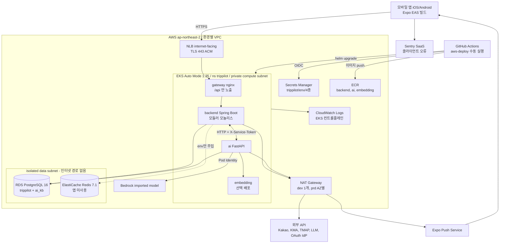

# TripPilot — Shared Infrastructure Design (As-Built)

> **문서 성격**: **as-built 기록**이다. 계획이 아니다. 인프라 배포는 이미 끝났고(사용자 결정 2026-10-12), 이 문서는 리포 코드에 **실재하는 것**을 AI-DLC Infrastructure Design 7개 범주로 옮겨 적는다. 코드에 없는 리소스는 적지 않는다.
> **배경**: U0~U6 은 Infrastructure Design 을 "배포/클라우드 계획 부재"를 사유로 SKIP 했다(`aidlc/aidlc-docs/aidlc-state.md` U0~U6 항목). 2026-08-31 결정은 AWS EKS, 그리고 인프라 문서 **통합 1건**이었다(백엔드가 단일 배포 단위인 모듈러 모놀리스라서). 이 문서가 그 1건이다. 그래서 유닛별 `infrastructure-design/` 폴더는 만들지 않았다.
> **정본 우선순위**: 이 문서는 지도다. 값이 갈리면 **코드가 이긴다**. Terraform `infra/terraform/**`, Helm `deploy/eks/chart/**`, 워크플로 `.github/workflows/aws-*.yml`, 런타임 도구 `deploy/eks/runtime*.py` 가 정본이다.
> **근거 표기**: 사실마다 `경로` 를 붙였다. Terraform 은 리소스 주소(`aws_db_instance.postgres` 등)로 가리킨다. 리소스 주소는 줄 번호보다 덜 흔들린다.
> **확인 범위**: 리포 코드만 봤다. AWS 콘솔이나 라이브 상태(실제 apply 된 tfvars 값, GitHub Environment 보호 설정, EAS 환경 시크릿)는 직접 확인하지 못했다. 그런 항목에는 **[라이브 미확인]** 을 달았다.

---

## 1. 핵심 사실 요약

| 항목 | As-built | 근거 |
|---|---|---|
| 클라우드·리전 | AWS, 기본값 `ap-northeast-2`(서울), 단일 리전 | `infra/terraform/stack/variables.tf` `aws_region` · `.github/workflows/aws-deploy.yml` `AWS_REGION` |
| 환경 | `dev` · `prd` 두 가지(validation 으로 고정). 환경마다 VPC·EKS·RDS·state 버킷이 따로 있다 | `variables.tf` `environment` · `infra/terraform/environments/{dev,prd}.tfvars` |
| **실사용 트래픽을 받는 환경** | **dev 스택**. 스토어 출시를 dev 로 받기로 했고(2026-10-04), prd 신설은 비용 문제로 보류했다 | `variables.tf` `data_protection_enabled` 설명 · `deploy/eks/chart/values-dev.yaml` 머리 주석 · `frontend/eas.json` production `EXPO_PUBLIC_API_BASE_URL=https://api-dev.trippilot.co.kr` |
| 컴퓨트 | EKS **Auto Mode**, Kubernetes 1.35. 노드풀은 `general-purpose`·`system`, amd64 | `infra/terraform/stack/eks.tf` `aws_eks_cluster.this` · `deploy/eks/chart/templates/_helpers.tpl` |
| 워크로드 | gateway(nginx) · backend(Spring Boot) · ai(FastAPI) · embedding(선택). 모두 네임스페이스 `trippilot` | `deploy/eks/chart/templates/*.yaml` |
| DB | RDS PostgreSQL 16, gp3 암호화, `rds.force_ssl=1`. Multi-AZ 는 **prd 만** 켜진다 | `infra/terraform/stack/data.tf` `aws_db_instance.postgres` |
| 캐시 | ElastiCache Redis 7.1(TLS 필수)가 프로비저닝돼 있으나 **백엔드에 Redis 클라이언트가 없어 쓰이지 않는다** | `data.tf` `aws_elasticache_replication_group.redis` · `backend/gradle/libs.versions.toml`(redis 의존 없음) · `docs/guides/aws-eks-deployment.md` |
| 메시징 | 브로커 없음. PostgreSQL 아웃박스와 ShedLock(JDBC) 릴레이로 처리한다 | `backend/app/src/main/kotlin/com/trippilot/app/event/OutboxRelay.kt` · `.../config/ShedLockConfig.kt` |
| 진입 | 인터넷 NLB(TLS 443, ACM) 뒤에 nginx gateway 가 있고, 외부로는 `/api` 만 노출한다 | `deploy/eks/chart/templates/services.yaml` · `gateway-config.yaml` |
| 시크릿 | Secrets Manager 그릇 4개를 배포 도구가 Kubernetes Secret 4개로 동기화한다 | `infra/terraform/stack/registry-secrets.tf` · `deploy/eks/runtime_secrets.py` |
| 배포 | GitHub Actions **수동 실행(workflow_dispatch) 하나**로 Terraform 과 Helm 을 함께 돌린다. OIDC 를 쓰고 Helm 은 `--atomic` | `.github/workflows/aws-deploy.yml` |
| 관측 | EKS 컨트롤플레인 로그는 CloudWatch 로 간다. **컨테이너 로그 수집은 기본 꺼짐**, 앱 OTel 도 꺼짐. **알람 리소스는 0건** | `eks.tf` · `environments/*.tfvars` `container_logs_enabled=false` · `templates/backend.yaml` `OTEL_SDK_DISABLED` |
| 클라이언트 배포 | Expo EAS 빌드 → App Store Connect 제출. 번들 `com.trippilot.travel` | `frontend/eas.json` · `frontend/app.config.ts` |

---

## 2. 배포 토폴로지

### 2.1 Mermaid



### 2.2 텍스트 대안

```
[모바일 앱] --HTTPS 443--> [NLB internet-facing, ACM TLS 종단]
    --> [gateway nginx: /api, /healthz 만. 그 외는 404]
        --> [backend :8080] <--HTTP + X-Service-Token--> [ai :8000] --> [embedding :8100 (선택)]
backend, ai --> [RDS PostgreSQL 16: DB trippilot(schema app), DB ai_kb(pgvector)]
backend --(env 만 주입, 클라이언트 없음)--> [ElastiCache Redis]
backend, ai --> [NAT] --> 외부 API (Kakao, KMA, TMAP, LLM, OAuth IdP, Expo Push)
ai --(EKS Pod Identity)--> [Bedrock imported model]
GitHub Actions --(OIDC 배포 역할)--> Terraform apply -> ECR 이미지 push -> Secrets 동기화 -> DB 부트스트랩 Job -> Helm -> 스모크 Job -> KB 적재 Job
```

---

## 3. 논리 컴포넌트 → 인프라 매핑

| 논리 컴포넌트 (설계 정본) | 인프라 자원 (as-built) | 근거 |
|---|---|---|
| 백엔드 모듈러 모놀리스(C1~C17 중 서버 측. 단일 배포 단위) | Deployment `backend`, 이미지 `ECR trippilot-<env>/backend`, Service `backend:8080`(ClusterIP) | `deploy/eks/chart/templates/backend.yaml` · `services.yaml` · `registry-secrets.tf` `aws_ecr_repository.app` |
| AI 서비스(라우터·워커·LLM Gateway·Assembly Engine) | Deployment `ai`(uvicorn 2 workers), ServiceAccount `ai` → Pod Identity → IAM `trippilot-<env>-ai-pod` | `templates/ai.yaml` · `eks.tf` `aws_eks_pod_identity_association.ai` · `infra/bootstrap/template.json` `AiPodRole` |
| 임베딩·RAG(Plan-B KB) | Deployment `embedding`(선택) + RDS 위 `ai_kb` DB 의 `public.kb_vectors`(pgvector) | `templates/embedding.yaml` · `deploy/eks/bootstrap.sql` |
| API 진입·레이트리밋(1차) | NLB(`eks.amazonaws.com/nlb`) + Deployment `gateway`(nginx, IP당 `10r/s`, burst 30, 초과 시 429) | `services.yaml` · `gateway-config.yaml` |
| PostgreSQL 정본(스키마 `app`, Flyway) | `aws_db_instance.postgres`(DB `trippilot`). 런타임 롤 `app_user`, 마이그레이션 롤 `app_migrate` | `data.tf` · `bootstrap.sql` · `backend/app/src/main/resources/application.yml` |
| 아웃박스 릴레이 + 분산 락 | backend 파드 안 `@Scheduled`(기본 2000ms) + `@SchedulerLock(outbox-relay)`. 락 저장소는 PostgreSQL `shedlock` 테이블 | `OutboxRelay.kt:83,95` · `ShedLockConfig.kt` |
| 그 밖의 스케줄러(여행 종료·알림 폴러·법정로그 보존·토큰 revoke·부분일정 정리) | backend 파드 안 `@Scheduled`. ShedLock 없이 조건부 UPDATE 로 멱등을 보장한다 | `modules/trip/.../TripEndSweeper.kt` · `modules/notification/.../NotificationSchedulePoller.kt` 외 주석 |
| 푸시(`PushPort` → `ExpoPushAdapter`) | 외부 SaaS Expo Push. 백엔드가 NAT 를 거쳐 호출한다. 모드 기본값 `off` | `deploy/eks/runtime_secrets.py` `BACKEND_DEFAULTS` · `aidlc/aidlc-docs/construction/u6-notification-settings/nfr-requirements/tech-stack-decisions.md` 델타 2 |
| 조회 캐시(U1-TS-4) | ElastiCache Redis. **앱 측 구현 없음**(§10 G-01) | `data.tf` · `aidlc/aidlc-docs/construction/u1-accommodation-trip/nfr-requirements/tech-stack-decisions.md` |
| 시크릿 주입 인터페이스(U0 SEC-01 이연분) | Secrets Manager `trippilot/<env>/{backend,ai,database,shared}` → K8s Secret `trippilot-{backend,ai,database,shared}` | `registry-secrets.tf` `aws_secretsmanager_secret.app` · `runtime_secrets.py` |
| 법적 고지 페이지 | GitHub Pages(AWS 밖) | `.github/workflows/legal-pages.yml` |
| 사진 바이너리 | **서버 저장소 없음**(설계상 기기 로컬). 그래서 S3 앱 버킷도 없다 | `aidlc/aidlc-docs/construction/u5-records-reflection/functional-design/business-rules.md` BR-U5-11 · Terraform 에 앱용 `aws_s3_bucket` 없음 |
| 지도 | 클라이언트 SDK(네이버 지도). 서버 인프라 없음, 키는 앱 빌드 env | `frontend/app.config.ts` `EXPO_PUBLIC_NAVER_MAP_CLIENT_ID` |

---

## 4. 범주별 As-Built

### 4.1 Deployment Environment

- **환경 정의**: `dev`·`prd` 두 값만 허용한다(`variables.tf` `environment` validation). 리소스 이름 접두는 `trippilot-<env>` 이다(`network.tf` `local.name`).
- **환경별 고정 차이**

| 축 | dev | prd | 근거 |
|---|---|---|---|
| VPC CIDR | `10.40.0.0/16` | `10.50.0.0/16` | `environments/*.tfvars` |
| AZ 수 | 2 | 3(validation 이 강제) | `variables.tf` `availability_zone_count` |
| NAT | 1개 공유 | AZ마다 1개(validation 이 강제) | `variables.tf` `single_nat_gateway` |
| RDS 클래스·스토리지 | `db.t4g.small`, 20→100GiB | `db.t4g.medium`, 100→1000GiB | `environments/*.tfvars` |
| RDS Multi-AZ | 꺼짐 | 켜짐 | `data.tf` `multi_az = local.production` |
| Redis | `cache.t4g.micro`, 노드 1, 페일오버 없음 | `cache.t4g.small`, 노드 3, 자동 페일오버, Multi-AZ | `data.tf` `num_cache_clusters` 등 |
| 컨테이너 로그 보존(켤 때) | 7일 | 30일 | `environments/*.tfvars` |
| 배포 브랜치 | `develop` | `main` | `infra/scripts/workflow_config.py` `settings()` |
| Terraform state | `trippilot-tfstate-<account>-<region>-dev` | `...-prd` | `workflow_config.py` · `infra/bootstrap/template.json` `TerraformStateBucket` |

- **데이터 보호 축은 환경과 분리돼 있다**: `data_protection_enabled`(기본 `true`)가 RDS 삭제 보호, 백업 보존 14일(꺼지면 1일), EKS 삭제 보호, Secrets 복구 창 30일(꺼지면 7일)을 함께 정한다. 두 tfvars 모두 이 값을 덮어쓰지 않으므로 **dev 에서도 보호가 켜져 있다**(`variables.tf` · `data.tf` · `eks.tf` · `registry-secrets.tf`).
- **dev 가 사실상 운영 환경이다**: §1 의 근거 세 곳(`variables.tf` 설명, `values-dev.yaml` 주석, `eas.json`)이 같은 사실을 가리킨다. prd 스택이 실제로 apply 됐는지는 코드로 알 수 없다 **[라이브 미확인]** → 계획서 Q1.

> **[개정 · 2026-10-12 · Infra 결정]** Q1=A — **dev 스택이 운영을 겸한다**. prd 는 당분간 만들지 않고, 재평가 트리거(유료 매출 발생 · DAU 가 SCALE-01 가정의 30% 도달 · 월 가용성 99.5% 미달)에 걸리면 다시 묻는다. prd 미적용 여부의 라이브 확인은 후속 작업이다(§12).

- **계정**: `vars.AWS_ACCOUNT_ID`(GitHub Environment 변수)로 주입된다. provider 의 `allowed_account_ids` 가 다른 계정 자격 증명을 거절한다(`versions.tf`). dev 와 prd 가 같은 계정인지 다른 계정인지는 리포에 없다 **[라이브 미확인]**(`docs/guides/aws-eks-deployment.md` 는 둘 다 가능하다고 적는다).
- **부트스트랩**: CloudFormation 스택 `trippilot-<env>-bootstrap` 이 state 버킷, 클러스터·노드·AI 파드·CloudWatch 파드 역할, GitHub OIDC 배포 역할을 소유한다. 종료 보호가 켜져 있다(`.github/workflows/aws-bootstrap.yml` · `infra/bootstrap/template.json`).

### 4.2 Compute Infrastructure

- **클러스터**: `aws_eks_cluster.this`. Auto Mode(`compute_config.enabled=true`, 노드풀 `general-purpose`·`system`), 블록 스토리지·ELB 관리를 켰고, 인증 모드는 `API`(Access Entry), `upgrade_policy STANDARD` 다. 노드는 private compute 서브넷에만 뜬다(`eks.tf`).
- **애드온**: `metrics-server`(HPA 전제)가 있고, `amazon-cloudwatch-observability` 는 조건부(`container_logs_enabled`)다(`eks.tf`).
- **워크로드**

| 워크로드 | 이미지 | 복제본 (기본 / dev / prd) | HPA | 요청 → 한도 | 프로브 | 근거 |
|---|---|---|---|---|---|---|
| gateway | `nginxinc/nginx-unprivileged:1.30.5-alpine-slim` | 1 / 2 / 2 | 꺼짐(키는 있음) | 100m·64Mi → 500m·128Mi | `/healthz` | `values*.yaml` · `templates/gateway.yaml` |
| backend | ECR backend | 1 / 2 / 2 | **템플릿 자체가 없음** | 500m·1Gi → 2·2Gi, 힙 `MaxRAMPercentage=75` | startup·liveness `/actuator/health/liveness`, readiness `/actuator/health/readiness` | `templates/backend.yaml` · `templates/hpa.yaml`(ai·gateway 만) |
| ai | ECR ai | 1 / HPA 2~3 / 2 고정 | dev 만 켜짐(CPU 70%) | 500m·512Mi → 2·2Gi | `/health` | `templates/ai.yaml` · `values-dev.yaml` · `values-prd.yaml`(autoscaling 키 없음 → 기본 false) |
| embedding | ECR embedding | 1 / 1 / 1 (`embedding.enabled` 일 때만) | 없음(스키마가 거부) | 2·5Gi → 2·6Gi | startup·readiness `/ready`, liveness `/health` | `templates/embedding.yaml` · `templates/hpa.yaml` 주석 |

- **배포 시 일회성 Job**: DB 부트스트랩(`runtime.py bootstrap-db`), 스모크(`runtime.py smoke`), Plan-B KB 적재(`runtime.py load-kb`). 모두 `.github/workflows/aws-deploy.yml` 이 띄운다.
- **롤링·종료 계약**: backend·ai·gateway 는 `maxUnavailable: 0, maxSurge: 1` 이다. embedding 은 `maxUnavailable: 1, maxSurge: 0` 으로, 노드 증설을 롤아웃 임계 경로에 넣지 않으려고 이렇게 뒀다. 종료 유예는 660초이고(embedding 45초), 백엔드 graceful shutdown·비동기 대기와 uvicorn graceful 은 630초, NLB deregistration 도 630초다. 긴 일정 생성 요청(최대 약 610초)을 끊지 않으려는 값이다(`_helpers.tpl` · `backend.yaml` · `ai.yaml` · `services.yaml`).
- **분산·중단 예산**: topologySpread 를 zone·hostname 두 축에 `maxSkew 1` 로 걸었지만 `ScheduleAnyway`(선호일 뿐 보장은 아님)다. PDB `minAvailable: 1` 은 backend·ai·gateway 에만 걸리고 dev·prd 모두 켜져 있다(`_helpers.tpl` · `templates/pdb.yaml` · `values-dev.yaml` 주석).
- **파드 보안 컨텍스트**: runAsNonRoot, 고정 UID, seccomp RuntimeDefault, `readOnlyRootFilesystem`, `capabilities.drop: [ALL]`, `automountServiceAccountToken: false` 를 걸었고 `/tmp` 는 emptyDir 이다(`_helpers.tpl`).

### 4.3 Storage Infrastructure

| 자원 | 설정 | 근거 |
|---|---|---|
| RDS PostgreSQL 16 | gp3, `storage_encrypted`, 스토리지 자동 확장 상한, `publicly_accessible=false`, 파라미터 `rds.force_ssl=1`, 관리자 암호는 RDS 관리형 Secrets, CloudWatch 로그 내보내기 `postgresql`·`upgrade` | `data.tf` `aws_db_instance.postgres` · `aws_db_parameter_group.postgres` |
| RDS 백업 | 보존 14일(`data_protection_enabled`), 창 17:00-18:00 UTC, `skip_final_snapshot=false`, 최종 스냅숏 이름 `trippilot-<env>-final`, `delete_automated_backups=false`, 스냅숏 태그 복사 | `data.tf` 주석 포함 |
| 논리 DB | `trippilot`(스키마 `app`, 소유 `app_migrate`, 사용 `app_user`) · `ai_kb`(pgvector, `kb_vectors`, `ai_user`). **같은 인스턴스에 둘 다 있다** | `deploy/eks/bootstrap.sql` · `outputs.tf` `database_name` 설명 |
| 접속 | 백엔드 JDBC 는 `sslmode=require`, AI 벡터 DB URL 도 `sslmode=require` | `templates/backend.yaml` `DB_URL` · `runtime_secrets.py` `runtime_manifests()` |
| ElastiCache Redis 7.1 | 저장·전송 암호화, `transit_encryption_mode=required`, 인증 없음(네트워크 격리에만 의존), 스냅숏 보존 dev 1일·prd 7일 | `data.tf` `aws_elasticache_replication_group.redis` 주석 |
| ECR | 저장소 3개(`backend`·`ai`·`embedding`), `IMMUTABLE` 태그, `scan_on_push`, AES256, 태그 없는 레이어 14일 만료 | `registry-secrets.tf` |
| Secrets Manager | 그릇 4개만 Terraform 이 만든다. 값은 Terraform 밖에 있다(state 에 비밀 0). 복구 창 30일 | `registry-secrets.tf` 주석 |
| Terraform state | S3 버전 관리, SSE AES256, 퍼블릭 차단, `aws:SecureTransport=false` 거부, native lockfile | `infra/bootstrap/template.json` `TerraformStateBucket`·`TerraformStateBucketPolicy` · `versions.tf` |
| 오브젝트 스토리지(앱용) | **없음** — 사진 바이너리를 서버에 두지 않는 설계 | BR-U5-11(§3 근거) |
| 데이터 수명 | 컨테이너 로그 그룹 보존 7·30일(켤 때), EKS 컨트롤플레인 로그 14·90일 | `eks.tf` `aws_cloudwatch_log_group.*` |

> **[개정 · 2026-10-12 · Infra 결정]** ElastiCache Redis 는 Q5=A 로 **제거하기로 했다**(앱 미사용, U1 Q8=B 는 "보류 → 철회"). 운영 환경(dev)의 컨테이너 로그 보존은 Q3=A 로 **90일**로 올린다. 위 표는 결정 시점의 as-built 그대로이고, 코드 반영은 후속 작업이다(§12).

- **법정 append-only 테이블**: DB 권한 수준(앱 롤 DELETE 없음)은 Flyway 마이그레이션이 소유하고, 인프라는 롤을 나누는 데까지만 맡는다(`bootstrap.sql` 의 `app_user`/`app_migrate` 분리, `application.yml` flyway user 분리).

### 4.4 Messaging Infrastructure

- **관리형 메시징(SQS·SNS·EventBridge·MSK) 없음**: Terraform 에 해당 리소스가 하나도 없다(`infra/terraform/stack/*.tf`). U0 의 "메시지 브로커 미도입"(`u0-foundation/nfr-design/nfr-design-patterns.md` §9)과 맞는다.
- **아웃박스**: 상태 변경과 같은 트랜잭션에서 `outbox_event` 에 쌓고, `OutboxRelay` 가 `fixedDelay`(기본 2000ms)로 폴링해 발행한 뒤 `published_at` 을 찍는다. 다중 복제본 중 하나만 돌도록 ShedLock `outbox-relay`(`lockAtMostFor=PT5M`, DB 시각 기준)를 쓴다(`OutboxRelay.kt:83-101,184` · `ShedLockConfig.kt`).
- **동기 서비스 간 호출**: backend ↔ ai 는 클러스터 내부 HTTP(`http://ai:8000`, `http://backend:8080`)이고 양방향 모두 `SERVICE_AUTH_TOKEN` 이 필수다(`templates/backend.yaml` · `templates/ai.yaml` 주석).
- **푸시**: Expo Push(외부 SaaS)를 `TRIPPILOT_PUSH_MODE`(기본 `off`)로 켠다. 배포 입력 `push_mode`(keep/off/expo)로 시크릿 값을 덮어쓸 수 있다(`aws-deploy.yml` 입력 · `runtime_secrets.py` `sync()`). iOS 빌드는 `aps-environment` entitlement 를 지운다(`frontend/app.config.ts` 끝 `withEntitlementsPlist`).
- **배치 수집**: POI(TourAPI)·행사 수집은 AWS 가 아니라 **GitHub Actions 스케줄**에서 돈다. POI 등록 제안은 리포 파일(`ai/data/collected_pois.json`)로 들어오고 backend 의 내부 수신 경계(`modules/place-data/.../PoiInternalController.kt`)가 받는다. 행사는 AI 이미지 안의 문서(`EVENTS_STORE=/app/data/collected_events.json`)로 읽힌다(`.github/workflows/ai-poi-collect.yml`·`ai-event-collect.yml` 머리 주석 · `templates/ai.yaml`).

### 4.5 Networking Infrastructure

- **서브넷 3계층**(AZ마다 하나씩, `network.tf`):
  - public `/24`(`cidrsubnet(/16, 8, i)`, ELB 태그) — NAT·NLB 자리
  - private compute `/20`(`cidrsubnet(/16, 4, i+1)`, internal-elb 태그) — EKS 노드, 기본 경로는 NAT
  - isolated data `/24`(`cidrsubnet(/16, 8, i+64)`) — RDS·Redis, **기본 경로 없음**(`aws_route_table.data`)
- **보안 그룹**: RDS 5432 와 Redis 6379 인바운드는 **EKS 클러스터 SG 참조만** 허용한다(`data.tf` `aws_vpc_security_group_ingress_rule.*`).
- **진입**: Service `gateway` type LoadBalancer, `loadBalancerClass: eks.amazonaws.com/nlb`, internet-facing, target-type ip, ACM 인증서로 443 TLS 종단, cross-zone 켜짐, client IP 보존, 헬스체크 HTTP `/healthz`. `loadBalancerSourceRanges` 기본값은 `0.0.0.0/0` 이다(`services.yaml` · `values.yaml`).
- **gateway 정책**: `/api`·`/api/` 만 backend 로 프록시하고, `/internal`·`/actuator` 를 포함한 나머지는 404 를 돌려준다. 외부에서 들어온 `X-Service-Token` 헤더는 지운다. HSTS(`max-age=31536000`)와 nosniff 를 붙이고 `server_tokens off`, 본문 상한 20m, `proxy_read_timeout 620s` 다(`gateway-config.yaml`).
- **클러스터 내부 격리**: NetworkPolicy(Ingress)는 backend ← gateway·ai·smoke, ai ← backend·smoke, embedding ← ai·kb-load 를 허용하고, gateway 는 포트만 연다(`templates/network-policy.yaml`). 정책이 실제로 강제되는지는 §10 G-12 를 본다.
- **EKS API 엔드포인트**: private 과 public 을 모두 켰고 `public_access_cidrs` 기본값은 `0.0.0.0/0` 이다(인증은 IAM/Access Entry). GitHub 호스팅 러너 때문에 이렇게 뒀다(`eks.tf` · `variables.tf` `eks_public_access_cidrs`).
- **DNS**: Route53 리소스가 없다. `API_HOSTNAME` → NLB DNS CNAME 은 도메인 소유자가 손으로 연결한다(`aws-deploy.yml` Deployment summary · `docs/guides/aws-eks-deployment.md`). 실제 dev 호스트는 `api-dev.trippilot.co.kr` 이다(`frontend/eas.json`).
- **이그레스**: 외부 API 는 모두 NAT 를 지난다. VPC 엔드포인트(ECR·S3·Secrets Manager·Bedrock)는 정의돼 있지 않다(`network.tf` 에 `aws_vpc_endpoint` 없음).

### 4.6 Monitoring Infrastructure

| 신호 | As-built | 근거 |
|---|---|---|
| EKS 컨트롤플레인 로그 | api·audit·authenticator·controllerManager·scheduler → `/aws/eks/trippilot-<env>/cluster`(14일, prd 90일) | `eks.tf` `aws_cloudwatch_log_group.eks` · `enabled_cluster_log_types` |
| 컨테이너 로그(stdout) | 애드온 `amazon-cloudwatch-observability` 는 **`container_logs_enabled=true` 일 때만** 설치된다. **두 tfvars 모두 `false`** → 이 상태로는 kubectl 로만 볼 수 있다 | `eks.tf` 주석 · `environments/dev.tfvars` · `prd.tfvars` |
| RDS 로그 | `postgresql`·`upgrade` 를 CloudWatch 로 내보낸다 | `data.tf` `enabled_cloudwatch_logs_exports` |
| 앱 메트릭·트레이스 | 이미지에 OTel Java 에이전트가 들어 있지만(sha256 검증) EKS 에서는 `OTEL_SDK_DISABLED=true`, exporter `none`, Micrometer OTLP 도 꺼져 있다. **수집기 없음** | `backend/Dockerfile` · `templates/backend.yaml` · `application.yml` `management.otlp` |
| 로컬 관측(참고) | kind + SigNoz(OTLP 로그·메트릭·트레이스) — AWS 와 별개 | `deploy/README.md` §관측성 |
| 리소스 메트릭 | `metrics-server`(HPA 용) | `eks.tf` `aws_eks_addon.metrics_server` |
| 클라이언트 | Sentry React Native(`@sentry/react-native ~7.2.0`). DSN 은 `EXPO_PUBLIC_SENTRY_DSN` 이 있을 때만 초기화하고 `sendDefaultPii: false`. EAS 빌드는 소스맵 자동 업로드를 끈다 | `frontend/src/app/entrypoint/initSentry.ts` · `frontend/app.config.ts` · `frontend/eas.json` |
| 합성·외부 감시 | 배포 직후 클러스터 내부 스모크 Job(gateway `/healthz`, backend readiness, ai `/health`) 1회. 매일 LLM 연결 스모크가 GitHub Actions 에서 돈다(배포된 API 를 감시하는 것은 아니다) | `deploy/eks/runtime_smoke.py` · `.github/workflows/ai-llm-smoke.yml` |
| **알람·대시보드** | **없음** — Terraform·Helm 어디에도 `aws_cloudwatch_metric_alarm`·SNS·대시보드 정의가 없다 | `infra/terraform/stack/*.tf` 전수 · `deploy/eks/chart/templates/*` 전수 |

> **[개정 · 2026-10-12 · Infra 결정]** Q3=A — CloudWatch 로 간다. `container_logs_enabled=true`(운영 dev 보존 90일), 최소 알람(5xx 비율 · RDS CPU·여유 스토리지·연결 수 · 파드 재시작/NotReady · OBS-02 리프레시 재사용 감지 로그 메트릭 필터)을 SNS → Slack 으로 보낸다. 담당자는 팀이 지정한다. 앱 메트릭·트레이스(G-05)는 범위 밖으로 남긴다. 위 표는 구현 전 as-built 이다(§12).

### 4.7 Shared Infrastructure

- **환경 간 공유 없음**: VPC·EKS·RDS·Redis·ECR·Secrets·state 버킷·IAM 역할이 모두 `trippilot-<env>` 로 나뉜다. 배포 동시성 그룹도 `aws-<env>` 라서 dev 와 prd 는 병렬로 돌 수 있고 같은 환경 안에서는 직렬이다(`aws-deploy.yml` `concurrency`).
- **환경 안 공유**
  - EKS 클러스터 1개, 네임스페이스 1개(`trippilot`)를 backend·ai·embedding·gateway 가 함께 쓴다.
  - RDS 인스턴스 1개를 backend(`trippilot` DB)와 ai(`ai_kb` DB)가 함께 쓴다. DB 와 롤은 나뉘어 있다(`bootstrap.sql`).
  - `trippilot-shared` 시크릿(`SERVICE_AUTH_TOKEN`)을 backend 와 ai 가 함께 쓴다.
- **멀티테넌시**: 해당 없음. B2C 단일 테넌트이고 테넌트를 가르는 인프라 구조가 없다.
- **이중 레지스트리**: 머지 게이트 CI 는 GHCR(`ghcr.io/<owner>/trippilot-{backend,frontend,ai}`)에 발행하고(`backend-ci.yml`·`frontend-ci.yml`·`ai-ci.yml`), AWS 배포는 **소스에서 다시 빌드해** ECR 에 올린다(`aws-deploy.yml` build-push 단계). GHCR 이미지는 로컬 compose 가 쓴다(`docker-compose.yml` `backend.image`).

---

## 5. 시크릿 흐름

```
[운영자] --값 입력(콘솔/CLI)--> Secrets Manager trippilot/<env>/{backend, ai, database, shared}
                                     |  (Terraform 은 그릇만 만든다. 값 0, state 0)
[aws-deploy.yml] --OIDC 배포 역할--> runtime.py sync-secrets
    1) 4개 그릇 읽기 -> allowlist 키만 허용 (그 밖의 키는 배포 실패)
    2) 빈 값 시드: DB 암호 3종, SERVICE_AUTH_TOKEN, JWT_SIGNING_KEY(RSA 2048 PKCS#8) — 이미 있으면 유지
    3) 모드 검증: kakao geocode면 KAKAO_CLIENT_ID 필수, kma면 WEATHER_API 필수, tripcom 3키, LLM 공급자 키
    4) 바뀐 그룹만 put-secret-value (0600 임시 파일 사용, 명령 인자와 로그에는 남기지 않음)
    5) kubectl apply (server-side) -> K8s Secret trippilot-{backend, ai, database, shared}
[Helm] secretKeyRef -> 파드 env  (Helm values 에는 비밀이 들어가지 않는다)
[RDS 관리자 암호] RDS 관리형 Secret -> DB 부트스트랩 Job 에만 임시 전달 -> cleanup-db 가 삭제
```

근거: `deploy/eks/runtime_secrets.py`(`GROUP_KEYS`·`seed_groups`·`validate_groups`·`put_secret`·`sync`) · `aws-deploy.yml`("Remove temporary database administrator credentials" 단계) · `registry-secrets.tf` 주석 · `docs/guides/aws-eks-deployment.md` §비밀값과 DB 초기화.

- **기동 차단 스위치**: 배포 환경은 `JWT_REQUIRE_CONFIGURED_KEY=true` 와 `SERVICE_AUTH_REQUIRE_TOKEN=true` 로 뜬다. 키가 비어 있으면 기동이 실패한다(`templates/backend.yaml` · `templates/ai.yaml` · `application.yml` 주석).
- **유실 축**: `SOCIAL_TOKEN_ENCRYPTION_KEY` 를 잃으면 RDS 스냅숏을 복원해도 provider revoke 토큰을 복호할 수 없다. 그래서 Secrets 복구 창을 데이터 보호 축에 묶었다(`registry-secrets.tf` 주석).
- **GitHub 측 비밀**: 수집·스모크 배치용 키(`TOUR_API_KEY*`, `AZUREAPIKEY` 등)는 AWS 가 아니라 Repository Secrets 에 있다(`ai-poi-collect.yml` · `ai-llm-smoke.yml` 머리 주석).

---

## 6. CI/CD · 롤백

### 6.1 파이프라인 지도

| 워크플로 | 트리거 | 하는 일 | AWS 변경 |
|---|---|---|---|
| `backend-ci.yml` · `ai-ci.yml` · `frontend-ci.yml` | push/PR(경로 필터) | 머지 게이트 테스트, GHCR 발행 | 없음 |
| `aws-bootstrap.yml` | 수동 | CloudFormation 부트스트랩(state 버킷·역할) | 있음(IAM·S3) |
| **`aws-deploy.yml`** | **수동만**(push·schedule·GitOps 없음) | 검증 → Terraform plan/apply → 이미지 빌드·ECR push → 시크릿 동기화 → DB 부트스트랩 → Helm → 스모크 → KB 적재 | 있음 |
| `ai-poi-collect` · `ai-event-collect` · `ai-llm-smoke` · `ai-serving-judge` · `ai-stay-measure` · `ai-business-status-reminder` | cron + 수동 | 실 API 수집·감시 배치 | 없음 |
| `legal-pages.yml` | develop push | 약관 페이지를 GitHub Pages 에 배포 | 없음 |

근거: 각 `.github/workflows/*.yml` 의 `on:` 블록.

### 6.2 `aws-deploy.yml` 단계와 안전장치

1. **validate 잡**(AWS 자격 증명 없이 실행): 인프라·배포 도구·차트 단위테스트, dev·prd 양쪽 `helm lint --strict`, `terraform fmt/validate/test`(오프라인), 앱 배포 시 `AsyncConfigTest`(종료 설정).
2. **deploy 잡**(GitHub Environment = 입력 환경)
   - `workflow_config.py`: 브랜치(dev=develop, prd=main), 역할 ARN 형식, ACM ARN, 호스트명을 **자격 증명을 받기 전에** 검증한다.
   - OIDC 역할 신뢰 조건은 `repo:<repo>:environment:<env>` 다(`infra/bootstrap/template.json` `DeploymentRole`).
   - ACM 인증서가 `ISSUED` 인지 확인 → `terraform plan -out` → (apply 모드이면) **저장한 plan 만** 적용한다.
   - 이미지 태그는 `sha-<commit>-<run_id>-<attempt>` 이고 ECR `IMMUTABLE` 이다.
   - `helm upgrade --install ... --atomic --wait --timeout 30m --history-max 10`
   - 클러스터 내부 스모크 → (embedding 이면) KB 적재 → 임시 DB 관리자 자격 증명 삭제 → 생성 파일 삭제.
3. **destroy 경로 없음**: 워크플로에 destroy 가 없다(`infra/tests/test_workflow_contracts.py` 가 계약으로 지킨다 — `data.tf` 주석이 이를 가리킨다).

### 6.3 롤백 (as-built)

| 실패 유형 | 메커니즘 | 근거 |
|---|---|---|
| Helm 롤아웃 실패(프로브·타임아웃) | `--atomic` 이 직전 릴리스로 자동 복귀한다 | `aws-deploy.yml` |
| 배포는 성공했으나 앱 결함 | 배포 브랜치에 revert 커밋 → 수동 재배포(새 태그). 워크플로에는 **이미지 태그 지정 입력이 없다** | `docs/guides/aws-eks-deployment.md` §확인과 복구 · `aws-deploy.yml` inputs |
| DB 마이그레이션 | 되돌리지 않는다(Flyway forward-only). expand-and-contract 규약이 롤백 가능성을 보장한다 | `u0-foundation/nfr-design/nfr-design-patterns.md` P-DEP-3 |
| 인프라 변경 | Helm 롤백 대상이 아니다. Terraform 을 다시 apply 한다 | `docs/guides/aws-eks-deployment.md` |
| 데이터 유실 | RDS PITR(보존 14일)·최종 스냅숏·자동 백업 보존 | `data.tf` |

> **[개정 · 2026-10-12 · Infra 결정]** Q6=B — **버전 핀 재배포를 구현한다**. `aws-deploy.yml` 에 기존 ECR 태그를 받는 입력을 추가해, 지정하면 빌드 없이 그 태그로 Helm 을 돌린다(ECR `IMMUTABLE` 이라 이전 이미지가 보존된다). `--atomic` 은 롤아웃 실패의 1차 안전망으로 유지한다. 구현 전까지는 위 표의 "revert 커밋 → 재배포"가 잠정 절차다. 목표 RTO 4시간 · RPO 15분(Q4=A)은 위 "데이터 유실" 행의 PITR 로 달성하며, 복원 리허설 1회로 근거를 만든다(§12).

---

## 7. 외부 의존 (이그레스)

| 의존 | 호출자 | 자격 증명 위치 | 켜는 스위치 (기본값) | 근거 |
|---|---|---|---|---|
| Google·Kakao·Naver·Apple OAuth | backend | `trippilot-backend` | 값이 있으면 사용 | `templates/backend.yaml` · `application.yml` `trippilot.social` |
| Kakao 로컬(지오코딩) | backend | `KAKAO_CLIENT_ID` | `PLACE_GEOCODE_MODE` (`stub`) | `runtime_secrets.py` `BACKEND_DEFAULTS` |
| 기상청(KMA) | backend · ai | `WEATHER_API` | `WEATHER_MODE` (`fake`) | 같은 파일 · `templates/ai.yaml` |
| Trip.com 제휴 딥링크 | backend(링크 생성) | `TRIPCOM_*` | `AFFILIATE_MODE` (`fallback`) | `runtime_secrets.py` |
| Expo Push | backend | `PUSH_EXPO_ACCESS_TOKEN`(선택) | `PUSH_MODE` (`off`) | `runtime_secrets.py` · `templates/backend.yaml` |
| LLM — OpenAI 호환 / Anthropic / 로컬 | ai | `trippilot-ai` | `TRIPPILOT_LLM_PROVIDER` (`openai`·`anthropic`·`mixed`·빈 값) | `runtime_secrets.py` `validate_groups` |
| LLM — Bedrock imported model | ai | IAM Pod Identity(키 없음) + `TRIPPILOT_BEDROCK_MODEL_ARN`·`_REGION` | 값이 있으면 사용 | `infra/bootstrap/template.json` `AiPodRole` · `templates/ai.yaml` |
| Kakao REST · TMAP · ODsay(대중교통) | ai | `KAKAO_REST_API_KEY` · `TMAP_API_KEY` · `ODSAY_API_KEY` | 값이 있으면 사용 | `templates/ai.yaml` |
| TourAPI | GitHub Actions 배치만 | Repository Secrets | 스케줄 | `ai-poi-collect.yml` |
| 네이버 지도 SDK | 앱(클라이언트) | `EXPO_PUBLIC_NAVER_MAP_CLIENT_ID`(빌드 env) | — | `frontend/app.config.ts` |
| Sentry | 앱(클라이언트) | `EXPO_PUBLIC_SENTRY_DSN` | DSN 이 있을 때 | `initSentry.ts` |

> 위 기본값은 **시크릿에 값이 없을 때** 적용되는 값이다. 라이브 시크릿에 무엇이 들어 있는지는 리포로 알 수 없다 **[라이브 미확인]**.

---

## 8. 클라이언트 배포 (모바일)

- **EAS 프로필**: `development`(dev client, internal), `preview`(internal), `production`(`autoIncrement`, `EXPO_PUBLIC_API_BASE_URL=https://api-dev.trippilot.co.kr`). 앱 버전 출처는 `remote` 다(`frontend/eas.json`).
- **제출**: App Store Connect `ascAppId 6819041997` 로 제출한다(`frontend/eas.json` `submit.production`).
- **식별자**: iOS `bundleIdentifier` 와 Android `package` 모두 `com.trippilot.travel`, `supportsTablet: false`, EAS `projectId 9d33458c-…`(`frontend/app.config.ts`).
- **서버와의 관계**: 앱은 공개 REST 만 쓴다. 서버 쪽 진입점은 §4.5 의 NLB→gateway 하나다. 클라이언트는 AWS 리소스를 직접 쓰지 않는다.

---

## 9. 확장 기준선 매핑

판정: **충족** · **부분** · **간극** · **범위 밖**(앱 코드·유닛 NFR 소관이라 인프라에서 판정하지 않음) · **확인 불가**(리포 밖 설정).

### 9.1 SECURITY (security-baseline Full, blocking)

| 규칙 | 판정 | 근거 / 비고 |
|---|---|---|
| SECURITY-01 저장·전송 암호화 | **충족** | RDS 암호화와 `force_ssl`, JDBC `sslmode=require`(`data.tf`·`backend.yaml`). Redis 저장·전송 암호화 required. ECR AES256. state S3 SSE 와 TLS 강제(`template.json`). 참고: 클러스터 내부 backend↔ai 는 평문 HTTP 다(데이터 저장소가 아니라 규칙 대상 밖이며, 서비스 토큰과 NetworkPolicy 로 보완한다) |
| SECURITY-02 중간자 접근 로그 | **간극** | NLB access log 속성 없음(`services.yaml`). nginx access log 는 stdout 뿐인데 컨테이너 로그 수집도 꺼져 있다(G-04·G-06) |
| SECURITY-03 앱 로깅 중앙화 | **부분** | 구조화 로그와 마스킹은 있으나(`deploy/README.md` §관측성 — `MaskingAppender`) 중앙 수집이 꺼져 있다(G-04) |
| SECURITY-04 HTTP 보안 헤더 | **범위 밖(제한 적용)** | API 는 HTML 을 서빙하지 않는다. gateway 가 HSTS(`includeSubDomains` 없음)와 nosniff 를 붙인다(`gateway-config.yaml`). HTML 약관 페이지는 GitHub Pages 에 있다 |
| SECURITY-05 입력 검증 | **범위 밖** · 인프라 층은 본문 20m 상한 | `gateway-config.yaml` `client_max_body_size` |
| SECURITY-06 최소 권한 | **부분** | 역할이 환경 ARN 으로 한정돼 있고 OIDC sub 도 환경으로 한정돼 있다. `RegionalDiscovery`·`ReadServingMetricsAndCost` 는 `Resource: "*"`(리소스 단위 권한을 지원하지 않는 조회 API로 보이지만 템플릿에 예외 근거가 적혀 있지 않다). AI 파드 Bedrock 권한은 리전 와일드카드 `bedrock:*:<acct>:imported-model/*`. 배포 역할은 클러스터 Admin 이다(`template.json` · `eks.tf`) |
| SECURITY-07 네트워크 제한 | **부분** | data 서브넷에 인터넷 경로 없음. DB·캐시 SG 는 SG 참조만 허용. NLB 는 443 만 연다. EKS API public `0.0.0.0/0`(IAM 인증). VPC 엔드포인트 없음(G-09) |
| SECURITY-08 앱 접근 제어 | **범위 밖** · 인프라 보완 | gateway 가 `/internal`·`/actuator` 를 차단하고 외부 `X-Service-Token` 을 제거한다(`gateway-config.yaml`) |
| SECURITY-09 하드닝 | **충족** | non-root·readOnlyRootFS·drop ALL·seccomp(`_helpers.tpl`). `server_tokens off`. RDS 관리형 암호(기본 자격 증명 없음). S3 퍼블릭 차단 |
| SECURITY-10 공급망 | **부분** | ECR scan_on_push·IMMUTABLE, OTel 에이전트 sha256 검증, lock 파일. 베이스 이미지가 digest 가 아니라 태그로 고정돼 있고(`backend/Dockerfile` `eclipse-temurin:25-jre`, `ai/Dockerfile` `python:3.12-slim`) SBOM 단계가 없다(G-13) |
| SECURITY-11 레이트리밋 | **충족**(인프라 층) | nginx IP당 10r/s, 429(`gateway-config.yaml`). 앱 2축 리미터는 U0 C-3 |
| SECURITY-12 하드코딩 자격 증명 금지 | **충족** | Secrets Manager. 비밀은 state·values 에 들어가지 않는다(`registry-secrets.tf` · `runtime_secrets.py`) |
| SECURITY-13 무결성·파이프라인 통제 | **부분 / 확인 불가** | 브랜치 검증, OIDC 환경 한정, destroy 없음. GitHub Environment 의 required reviewers·브랜치 규칙은 리포 밖 설정이다(`docs/guides/aws-eks-deployment.md`) |
| SECURITY-14 알림·모니터링 | **간극** | 알람 0건, 보안 이벤트 라우팅 없음, 컨테이너 로그 보존(켤 때) 7·30일 < 90일(G-03·G-04) |
| SECURITY-15 fail-safe | **충족**(인프라 층) | 키·토큰이 없으면 기동 실패(`backend.yaml`·`ai.yaml`). 시크릿 검증에 실패하면 배포가 중단된다(`runtime_secrets.py`) |

### 9.2 RESILIENCY (resiliency-baseline Full)

| 규칙 | 판정 | 근거 / 비고 |
|---|---|---|
| RESILIENCY-01 워크로드 중요도 분류 | **부분** | 공식 분류표는 없다. 암묵적 분류만 있다: PDB 대상 backend·ai·gateway / 강등 허용 embedding(INV-4)(`templates/pdb.yaml`·`values-dev.yaml` 주석) |
| RESILIENCY-02 가용성·복구 목표 | **부분** | AVAIL-01 99.9%(`u0-foundation/nfr-requirements/nfr-requirements.md`). **RTO·RPO 수치 미정의**(계획서 Q4) |
| RESILIENCY-03 변경 관리 | **충족** | Jira·Slack·Git(`aidlc-state.md` 복원력 결정 Q5=A). 배포는 수동 실행 + GitHub Environment |
| RESILIENCY-04 자동 배포·롤백 | **부분** | 자동화된 수동 트리거 파이프라인, 롤링, Helm atomic. NFR 이 고른 "버전 핀 재배포"(P-DEP-3)와 실제("revert 후 재배포")가 다르다(G-07, 계획서 Q6) |
| RESILIENCY-05 모니터링·알림 | **간극** | 메트릭·트레이스·대시보드 없음. 로그 수집 꺼짐(G-03·G-04·G-05) |
| RESILIENCY-06 헬스체크 | **부분** | 전 워크로드 startup·readiness·liveness. NLB→gateway `/healthz`(얕음). 배포 직후 스모크 1회. 외부 합성 감시 없음 |
| RESILIENCY-07 복원력 감시 | **간극** | 단일 AZ 운영·복제 지연·백업 실패 알람 없음 |
| RESILIENCY-08 다중 AZ | **부분** | prd: 3 AZ, RDS·Redis Multi-AZ, NAT AZ별, cross-zone NLB. **실사용 dev**: 컴퓨트 2 AZ, RDS 단일 AZ, Redis 노드 1, NAT 1(G-02). 파드 분산은 `ScheduleAnyway` 라 보장되지 않는다 |
| RESILIENCY-09 오토스케일 | **부분** | 노드는 Auto Mode 가 확장한다. ai HPA 는 dev 만 켜져 있다. **backend HPA 없음**(G-08). 서비스 쿼터 문서 없음 |
| RESILIENCY-10 의존 격리 | **범위 밖** · 인프라 층 타임아웃 | gateway connect 5s·read 620s. 앱 서킷·타임아웃은 유닛 NFR(U0 P-RES-2 등) |
| RESILIENCY-11 DR 전략 | **부분** | 단일 리전 + 다중 AZ 를 선택해 두었다(`aidlc-state.md` Q3=E·Q4=A). 페일오버·페일백 절차 문서는 없다 |
| RESILIENCY-12 백업·복제 | **부분** | 자동 백업 14일, PITR, 최종 스냅숏, 백업 암호화(스토리지 암호화 상속). 교차 리전은 Q3=E 근거로 비대상. **복원 검증 절차 없음**(G-15) |
| RESILIENCY-13 페일오버 런북 | **간극** | RDS Multi-AZ 자동 페일오버(prd 만) 외 런북 없음 |
| RESILIENCY-14 복원력 테스트 | **확인 불가** | RT-8·9·10(`nfr-design-patterns.md` §6) 실행 기록이 리포에 없다 |
| RESILIENCY-15 장애 대응 | **범위 밖** | 경량 대응 + COE(Q6=B). 인프라 산출물은 없다 |

> **[개정 · 2026-10-12 · Infra 결정]** 위 두 표의 판정은 **바꾸지 않는다** — 결정만으로 기준선이 충족되지는 않고, 판정은 후속 구현이 끝난 뒤 다시 매긴다. 결정으로 바뀐 것은 미결 상태다. SECURITY-14 · RESILIENCY-05·07(Q3), RESILIENCY-02·12(Q4), RESILIENCY-04(Q6), RESILIENCY-08(Q1·Q2 — 단일 AZ 데이터 계층을 수용하고 AVAIL-01 을 99.5% 로 낮췄다)가 "결정됨 — 구현 대기"로 넘어갔다. 결정 내용은 §12 에 있다.

---

## 10. 관측된 간극 (Gap)

> 인프라 코드와 NFR 설계 문서가 어긋나거나, 기준선이 요구하는데 인프라에 없는 것들이다. **고치는 결정은 이 문서 범위 밖**이고, 판단이 필요한 것만 계획서 질문으로 넘겼다.

| ID | 간극 | 증거 | 영향 |
|---|---|---|---|
| **G-01** | **Redis 를 프로비저닝했지만 쓰지 않는다** | 인프라: `data.tf` `aws_elasticache_replication_group.redis`, `backend.yaml` 이 `REDIS_HOST`·`SPRING_DATA_REDIS_*` 주입. 앱: `backend/gradle/libs.versions.toml` 에 Redis 클라이언트 없음, `modules/accommodation-search/build.gradle.kts:2` "Redis 캐시는 실 벤더 어댑터 단계", `docs/guides/aws-eks-deployment.md` "backend 에는 Redis adapter 구현이 없어", `backend/docs/design/work-graph.toml:2509` "Redis 유휴(TRIP-895)". 설계 3개가 서로 다르다: U0 미도입(`u0-foundation/nfr-design/nfr-design-patterns.md` §9) → U1 도입(`u1-.../tech-stack-decisions.md` U1-TS-4) → U6 "보류 상태 유지"(`u6-.../tech-stack-decisions.md`) | 비용만 나간다(prd 이면 노드 3개). TLS·SG 를 갖춘 공격면이 놀고 있다. 문서와 실제가 어긋난다 → 계획서 Q5 **[개정 · 2026-10-12] 결정됨 — 후속 작업(팀)**: Q5=A 제거. Terraform `aws_elasticache_*`·Redis SG·`redis_node_type`·`redis_host/port` 출력 삭제, Helm `config.redisHost/Port`·backend Redis env 삭제, `deploy/eks/runtime.py` 필수 출력에서 `redis_host` 삭제, 관련 tftest·python 테스트 갱신. |
| **G-02** | **실사용 트래픽이 dev 스택에 있고, dev 데이터 계층은 단일 AZ 다** | `variables.tf` 설명 "스토어 출시를 dev 스택으로 받기로(2026-10-04)", `values-dev.yaml` "prd 신설은 비용 보류", `eas.json` production → `api-dev`. dev: `multi_az = local.production`(false), Redis `num_cache_clusters` 1, `single_nat_gateway=true` | AVAIL-01(99.9%, 다중 AZ 전제)과 SCALE-03 을 데이터 계층이 충족하지 못한다. AZ 장애 때 RDS 를 복구하는 동안 서비스가 중단되고, NAT 가 하나라 이그레스도 단일 장애점이다 → 계획서 Q1·Q2 **[개정 · 2026-10-12] 결정됨 — 후속 작업(팀)**: Q1=A·Q2=A. 단일 AZ 데이터 계층을 수용하고 AVAIL-01 을 월 99.5% 로 낮췄다(U0 `nfr-requirements.md` 개정 블록). 인프라 변경은 없다. 남은 일: prd 미적용 라이브 확인, GitHub Environment `dev` 보호 규칙 확인·설정. |
| **G-03** | **알람·알림 라우팅이 0건이다** | `infra/terraform/stack/*.tf` 에 `aws_cloudwatch_metric_alarm`·`aws_sns_topic` 없음, 차트에도 없음 | U0 OBS-02(보안 이벤트 5분류 — "수집·라우팅은 Infra Design 이연")가 미해소다. SECURITY-14 와 RESILIENCY-05·07 도 간극으로 남는다 → 계획서 Q3 **[개정 · 2026-10-12] 결정됨 — 후속 작업(팀)**: Q3=A. 알람·SNS 토픽·Slack 연결을 Terraform 에 추가한다(5xx 비율, RDS CPU·여유 스토리지·연결 수, 파드 재시작/NotReady, OBS-02 리프레시 재사용 감지 로그 메트릭 필터). 담당자를 지정한다. |
| **G-04** | **컨테이너 로그 중앙 수집이 꺼져 있다** | `environments/dev.tfvars`·`prd.tfvars` `container_logs_enabled = false`(주석: 2026-10-03 기준 cloudwatch-pod 역할 부재). `eks.tf` 주석 "Container stdout is otherwise reachable only through kubectl". 그런데 `docs/guides/aws-eks-deployment.md` 는 "Pod 로그는 … CloudWatch Logs 에서 본다"고 적는다(**문서 드리프트**). 켜도 보존은 7·30일이다 | 사고 뒤 로그를 추적하기 어렵다(파드가 교체되면 로그도 사라진다). SECURITY-03·14(90일) 간극. 라이브에서 켰는지는 **[라이브 미확인]** → 계획서 Q3 **[개정 · 2026-10-12] 결정됨 — 후속 작업(팀)**: Q3=A. bootstrap 재실행(`cloudwatch-pod` 역할 생성) → `dev.tfvars` `container_logs_enabled=true`·보존 90일 → deploy. 가이드의 로그 서술을 실제와 맞춘다. |
| **G-05** | **앱 메트릭·트레이스가 없다** | `backend.yaml` `OTEL_SDK_DISABLED=true`, exporter `none`, `OTEL_METRICS_ENABLED=false`. OTLP 수집기 없음(`eks.tf` 주석). 로컬 SigNoz 에만 있다(`deploy/README.md`) | p95(PERF-01)와 오류율을 운영에서 측정할 수단이 없다. RESILIENCY-05 간극 |
| **G-06** | **NLB access log 가 없다** | `services.yaml` 주석·속성에 access log 설정 없음 | SECURITY-02 간극 |
| **G-07** | **롤백 메커니즘이 NFR 선택과 다르다** | NFR: "이전 아티팩트 버전 재배포(버전 핀)"와 RT-9 롤백 리허설을 "최초 프로덕션 배포 전 1회 필수"로 정했다(`u0-.../nfr-design-patterns.md` P-DEP-3·§6). 실제: Helm `--atomic`(실패 시 자동) + "revert 커밋 후 재배포"(`docs/guides/aws-eks-deployment.md`). 워크플로에 이미지 태그 입력이 없다(`aws-deploy.yml`). RT-9 실행 기록이 리포에 없다 | 배포가 성공했는데 결함이 있을 때 복구하려면 다시 빌드해야 한다(빌드 시간만큼 RTO 가 늘어난다). RESILIENCY-04 는 롤백 방식을 사용자가 명시적으로 고르도록 요구한다 → 계획서 Q6 **[개정 · 2026-10-12] 결정됨 — 후속 작업(팀)**: Q6=B. `aws-deploy.yml` 에 이미지 태그 입력(존재·형식 검증, 지정 시 build-push 생략) 추가, `infra/tests/test_workflow_contracts.py` 계약 갱신, RT-9 롤백 리허설 1회와 기록. |
| **G-08** | **backend 오토스케일이 없다** | `templates/hpa.yaml` 은 ai·gateway 만 다룬다. backend 는 `replicas` 고정(dev·prd 2). gateway HPA 는 꺼져 있고 prd ai HPA 도 꺼져 있다(`values-prd.yaml`) | NFR P-SCALE-1 "수평 오토스케일"과 SCALE-02 "10x 스파이크"를 고정 복제본 2개가 받아 내야 한다. 노드 확장(Auto Mode)은 HPA 없이는 파드 수를 늘리지 않는다 |
| **G-09** | **VPC 엔드포인트가 없다** | `network.tf` 에 `aws_vpc_endpoint` 없음 | ECR pull·Secrets·Bedrock 트래픽이 NAT 를 지나 비용이 들고, dev 에서는 NAT 단일 장애점에 묶인다. SECURITY-07 "private endpoints" 권고 미충족 |
| **G-10** | **JWT 알고리즘이 NFR 과 다르다** | NFR: ES256 + JWK 셋(`u0-.../nfr-requirements.md` SEC-01 · `tech-stack-decisions.md` §3). 실제: RS256, 배포 도구가 RSA 2048 PKCS#8 을 시드한다(`application.yml` `trippilot.jwt` 주석 · `runtime_secrets.py` `rsa_key`) | 인프라 결함은 아니다. 다만 시크릿 형식(키 종류)이 문서와 달라 키 롤오버 절차(P-SEC-2)를 다시 확인해야 한다 |
| **G-11** | **푸시 채널이 as-built 기본값에서 꺼져 있다** | `PUSH_MODE` 기본 `off`(`runtime_secrets.py`). iOS `aps-environment` 제거(`frontend/app.config.ts`). 루트 `CLAUDE.md` 는 외부 API 로 "FCM" 을 적지만 U6 결정은 Expo Push 다(`u6-.../tech-stack-decisions.md` DEC-U6-3) | 리마인드·Plan-B 푸시 같은 알림 설계가 운영에서 발화하지 않을 수 있다. 라이브 `push_mode` 는 **[라이브 미확인]** |
| **G-12** | **NetworkPolicy 강제 여부가 확인되지 않는다** | 차트는 NetworkPolicy 를 정의한다(`network-policy.yaml`). 그러나 EKS Auto Mode 에서 네트워크 정책 강제를 켜는 구성(NodeClass·VPC CNI 설정)은 리포에서 찾지 못했다(`infra/`·`deploy/eks/` 검색 0건) | 강제가 꺼져 있으면 파드 간 격리가 서비스 토큰 하나에만 의존한다. 라이브에서 확인해야 한다 **[라이브 미확인]** |
| **G-13** | **공급망 보강 항목이 빠져 있다** | 베이스 이미지 태그 고정(`backend/Dockerfile`·`ai/Dockerfile`·`ai/embedding/Dockerfile`), SBOM 단계 없음(`aws-deploy.yml`), GitHub Actions 는 메이저 태그 고정(`@v4` 등) | SECURITY-10 부분 충족 |
| **G-14** | **테스트한 이미지와 배포 이미지가 다르다** | CI 는 GHCR 에 발행하고(`backend-ci.yml` 등), AWS 배포는 같은 커밋을 다시 빌드한다(`aws-deploy.yml` build-push) | 머지 게이트를 통과한 바이너리와 운영 바이너리가 같은 산출물이라는 보장이 없다(같은 소스, 다른 빌드) |
| **G-15** | **RTO/RPO 와 복원 검증이 정의돼 있지 않다** | NFR 은 AVAIL-01(99.9%)만 정했다(`u0-.../nfr-requirements.md`). 백업은 있으나(`data.tf`) 복원 리허설 절차·기록이 없다 | RESILIENCY-02·12·13 간극 → 계획서 Q4 **[개정 · 2026-10-12] 결정됨 — 후속 작업(팀)**: Q4=A. RTO 4시간 · RPO 15분으로 확정(U0 `nfr-requirements.md` 개정 블록). PITR 복원 리허설 1회(별도 인스턴스 복원 → 앱 연결 → 소요 시간 기록). 결과가 4시간을 넘으면 수치를 다시 묻는다. |
| **G-16** | **배포 가이드 문서가 코드와 어긋난다** | `docs/guides/aws-eks-deployment.md` 표의 "DEV backend + AI 각 1 replica"는 `values-dev.yaml`(backend 2, ai HPA 2~3, gateway 2)과 다르다. 로그 서술도 다르다(G-04) | 운영자가 가이드를 믿으면 잘못 판단할 수 있다. 정본은 차트와 tfvars 다 |

---

## 11. 미결 항목

코드로 답할 수 없는 항목은 `plans/shared-infrastructure-design-plan.md` 의 질문 Q1~Q6 으로 넘겼다(운영 환경 정체·dev 데이터 계층 AZ·관측/알림 소유·RTO/RPO·Redis 처분·롤백 방식). 답이 오면 이 문서의 해당 절과 §10 판정을 고친다.

> **[개정 · 2026-10-12 · Infra 결정]** Q1~Q6 이 모두 정해졌다(2026-10-12, 사용자 일괄 지시 "그럼 권고로 ㄱㄱ" → AI 권고 적용). 결정과 후속 작업은 §12 에 있다. 이 절에 남은 미결은 없다. 다만 **[라이브 미확인]** 항목(prd apply 여부 · 계정 구성 · GitHub Environment 보호 · 라이브 시크릿 값 · NetworkPolicy 강제 G-12)은 결정이 아니라 확인 대상이라 그대로 남는다.

---

## 12. 확정 결정 (2026-10-12)

> **결정 경위**: 계획서 `plans/shared-infrastructure-design-plan.md` Q1~Q6 에 권고 표시가 없는 상태에서, 사용자가 "그럼 권고로 ㄱㄱ"라고 일괄 지시했다. 그래서 AI 가 근거를 붙여 권고안을 골랐다. 근거 전문은 계획서 각 `[Answer]:` 에 있다. 선택 기준은 두 가지다. as-built 와 비용 기조(prd 신설 비용 보류, 2026-10-04)에 맞출 것, 그리고 라이브 스토어 앱에 안전하지 않은 간극은 받아들이지 않을 것.
> **범위**: 아래 "후속 작업"은 팀이 각 패키지·인프라 디렉토리에서 직접 한다. AI-DLC 범위 밖이다(SCOPE: CONSTRUCTION 설계 문서만). 사용자 승인과 `audit.md`·`aidlc-state.md` 기록은 아직 하지 않았다.

| Q | 결정 | 한 줄 근거 | 후속 작업 (팀) | 개정한 NFR 문서 |
|---|---|---|---|---|
| Q1 운영 환경 | **A** — dev 스택이 운영을 겸한다. prd 는 당분간 만들지 않는다 | 코드 세 곳이 같은 사실을 가리키고, 이전 시점 기록이 없다. 재평가 트리거: 유료 매출 · DAU 가 SCALE-01 의 30% · 99.5% 미달 | prd 미적용 라이브 확인 · GitHub Environment `dev` required reviewers · 가이드 "DEV" 서술 정정(G-16) | — |
| Q2 dev 단일 AZ 데이터 계층 | **A** — 수용하고 AVAIL-01 을 월 **99.5%** 로 낮춘다 | 데이터 보호(PITR·삭제 보호·스냅숏)는 켜져 있어, AZ 장애 때 잃는 것은 데이터가 아니라 시간이다. RDS Multi-AZ 는 요금이 약 두 배 | 인프라 변경 없음. 트리거에 걸리면 `multi_az` 를 별도 변수로 분리(B) | U0 `nfr-requirements.md` AVAIL-01 · SCALE-03 |
| Q3 관측·알림 | **A** — CloudWatch 로그 수집 + 최소 알람 → SNS → Slack, 담당자 지정 | SECURITY-14·RESILIENCY-05 는 blocking 이고, 라이브 앱에 알람 0건은 안전하지 않다. 애드온 분기·역할 정의가 이미 있어 비용이 작다 | bootstrap 재실행 → `container_logs_enabled=true`·보존 90일 → 알람·SNS Terraform → 담당자 지정 → 가이드 로그 서술 정정(G-04). OTel(G-05)은 범위 밖 | U0 `nfr-requirements.md` OBS-02 |
| Q4 RTO/RPO | **A** — RTO 4시간 · RPO 15분, 복원 리허설 1회 | 현재 인프라(PITR 14일 + 수동 배포)로 낼 수 있는 값이다. B 는 Q2=A 와 충돌한다 | PITR → 별도 인스턴스 복원 리허설 1회와 소요 시간 기록. 4시간 초과면 다시 묻는다 | U0 `nfr-requirements.md` §4 (RTO/RPO 추가) |
| Q5 Redis | **A** — 제거한다. U1 Q8=B "Redis 도입"은 "보류 → 철회" | 앱 클라이언트 0건, 구현 티켓 없음(TRIP-895 는 유휴 지적), U1 설계가 이미 PG 폴백 전제, 인증 없는 유휴 공격면 | Terraform `aws_elasticache_*`·SG·변수·출력 삭제, Helm `config.redis*`·backend env 삭제, `deploy/eks/runtime.py` `redis_host` 필수 제거, 테스트 갱신, compose redis 정리(선택) | U1 `tech-stack-decisions.md` U1-TS-4 · `nfr-requirements.md` · `nfr-design-patterns.md` P-PERF-U1-2 · `logical-components.md` |
| Q6 롤백 방식 | **B** — 버전 핀 재배포를 구현한다. `--atomic` 은 1차 안전망으로 유지 | NFR(P-DEP-3·RT-9)이 이미 골랐고, ECR `IMMUTABLE` 로 이전 이미지가 보존된다. A 는 롤백마다 재빌드라 RTO 가 늘고 미검증 바이너리가 나간다 | `aws-deploy.yml` 이미지 태그 입력(검증·build-push 생략) · 워크플로 계약 테스트 갱신 · RT-9 리허설 1회. 구현 전에는 revert 재배포가 잠정 절차 | U0 `nfr-design-patterns.md` P-DEP-3 (구현 상태만 덧붙임) |

### 12.1 후속 작업 목록 (팀, 우선순위 순)

1. **관측 기준선(Q3)** — bootstrap 재실행 → 컨테이너 로그 켜기(보존 90일) → 최소 알람 + SNS → Slack → 담당자 지정. 라이브 앱의 안전 간극이라 가장 먼저 한다.
2. **롤백 핀(Q6)** — `aws-deploy.yml` 이미지 태그 입력과 계약 테스트, 그리고 RT-9 리허설.
3. **복원 리허설(Q4)** — PITR 복원 1회, 소요 시간 기록.
4. **Redis 제거(Q5)** — Terraform·Helm·runtime·테스트. 제거 apply 는 dev 운영 스택에 대한 변경이므로 plan 을 먼저 검토한다.
5. **운영 환경 정리(Q1)** — prd 미적용 라이브 확인, `dev` Environment 보호 규칙, 가이드 정정(G-04·G-16).

이번 결정 범위 밖으로 남는 간극: G-05(앱 메트릭·트레이스), G-06(NLB access log), G-08(backend HPA), G-09(VPC 엔드포인트), G-10(JWT 알고리즘), G-11(푸시 기본 off), G-12(NetworkPolicy 강제), G-13(공급망), G-14(CI 이미지 ≠ 배포 이미지).

---

## U10 증분 (2026-10-12)

> **성격**: 이 절은 위 as-built 본문과 달리 **설계 증분**이다 — U10(GPS·위치 자동화)이 인프라에 요구하는 것을 적고, 아직 코드에 없다. 구현은 팀이 각 디렉토리에서 한다(SCOPE). 근거 설계: `u10-gps-location-automation/nfr-requirements/`(REL-U10-03·06 · PERF-U10-05·06 · OBS-U10-\*) · `u10-gps-location-automation/nfr-design/`(P-\*-U10) · 계획서 `plans/u10-gps-location-automation-nfr-design-plan.md`(Q2=A).
> **결론 먼저**: **신규 AWS 자원 0.** 늘어나는 것은 백엔드 런타임 키 1개 · 파드 안 스케줄러 2개 · 마이그레이션 3건 · EAS 프로필 1개 · 로그 기반 관측 쿼리다.

### U10.1 신규 AWS 자원이 없는 이유 (검증)

| 범주 | U10이 쓰는 것 | 기존 자원 | 판정 |
|---|---|---|---|
| Compute | 자동 결과 배치·경로 PUT/GET·구간 보고 API, 스케줄러 2개 | Deployment `backend`(같은 이미지·같은 파드) | 신규 0 |
| Storage | `actual_route_day`(하루 ≤ 2,000점 인코딩 ≈ 수십 KB 이하/여행·일) · `location_automation_interval`(무장 하루 ≈ 4행) · `visit_check` 컬럼 2 | RDS PostgreSQL 16(`aws_db_instance.postgres`, dev 20→100GiB 자동 확장) | 신규 0. **원시 좌표는 서버에 오지 않는다**(INV-U10-2) — S3 등 오브젝트 저장소 불필요 |
| Messaging | 이벤트 3종(`VisitChecked` 확장 · `VisitAutoReverted` · `ActualRouteStored`) | PostgreSQL 아웃박스 + `OutboxRelay`(§4.4) | 신규 0 |
| Networking | 공개 REST 4종(`/api` 아래) | NLB → gateway `/api` 프록시 · 본문 상한 20m · IP당 10r/s | 신규 0. 앱 본문 상한(자동 결과 64KB · 경로 256KB, PERF-U10-05)은 **앱이 413으로 집행**한다 — gateway 20m은 그대로. 기기 wake당 요청 ≤ 2라 레이트리밋과 충돌 없음 |
| Secrets | 킬 스위치 키 1개(비밀 아님 — U10.2) | `trippilot/<env>/backend` 그릇 | 신규 그릇 0 |
| IAM | 없음(기기는 AWS를 직접 쓰지 않는다 — §8) | — | 신규 0 |
| Monitoring | 구조화 로그 1줄/사건 · DB 질의(U10.6) | §12 Q3=A로 켜질 CloudWatch 컨테이너 로그 | 신규 0(Q3 후속 작업에 얹힌다) |

`infra/terraform/stack/*.tf`·`deploy/eks/chart/templates/*`에 U10 때문에 추가할 리소스 주소가 없다. 바뀌는 인프라 파일은 **런타임 도구·차트 env 배선·배포 입력·EAS 설정**뿐이다(아래).

### U10.2 서버 킬 스위치 (REL-U10-06 · Q2=A)

`PUSH_MODE`와 같은 통로를 쓴다 — **커밋 없이 끌 수 있어야** 해서다.

```
Secrets Manager trippilot/<env>/backend
  LOCATION_AUTOMATION_ENABLED = "true" | "false"        (없으면 BACKEND_DEFAULTS 의 "true")
    |  runtime.py sync-secrets  (허용 키 목록 BACKEND_KEYS 에 추가)
    v
K8s Secret trippilot-backend
    |  trippilot.secretEnv (optional)  -- templates/backend.yaml
    v
env TRIPPILOT_LOCATION_AUTOMATION_ENABLED
    |  application.yml  trippilot.location-automation.enabled: ${TRIPPILOT_LOCATION_AUTOMATION_ENABLED:true}
    v
구간 START -> 꺼짐이면 409 AUTOMATION_DISABLED / 자동 결과 배치 응답 automationEnabled
```

| 변경 지점 | 내용 | 계약 테스트 |
|---|---|---|
| `deploy/eks/runtime_secrets.py` | `BACKEND_KEYS`에 `LOCATION_AUTOMATION_ENABLED` · `BACKEND_DEFAULTS`에 `"true"` · 값 검증(`true`/`false`만) | `deploy/eks/tests/test_runtime.py`(`PUSH_MODE` 케이스 꼴) |
| `.github/workflows/aws-deploy.yml` | 입력 `location_automation: keep \| on \| off`(기본 `keep`) — `push_mode`와 같은 덮어쓰기 경로 | `infra/tests/test_workflow_contracts.py`(`PUSH_MODE_INPUT` 단언 꼴) |
| `deploy/eks/chart/templates/backend.yaml` | `trippilot.secretEnv`(optional) 1줄 | 차트 렌더 |
| `backend/app/src/main/resources/application.yml` | 위 키 · 기본 `true` | 백엔드 테스트 |

- **반영 지연 = 배포 워크플로 1회.** 배포마다 `rolloutNonce`로 파드가 재시작돼 새 env를 읽는다. §12 Q6=B(이미지 태그 핀)가 구현되면 재빌드가 빠져 더 짧아진다 — 킬 스위치가 Q6 후속 작업의 수혜자다.
- **값은 비밀이 아니다.** 시크릿 그룹에 두는 이유는 "커밋·리뷰 없이 바꾼다"는 성질 하나다(`PLACE_GEOCODE_MODE`·`WEATHER_MODE`와 같은 이유).
- 기기는 응답을 못 받으면 직전 값을 유지하고, 꺼진 뒤 다시 켜짐은 포그라운드 복귀 시 빈 배치 탐침으로 안다(P-STORE-U10-3). 서버 쪽 추가 장치는 없다.
- 끄는 판단·실행 담당은 §12 Q3의 알람 담당자와 같은 사람으로 둔다(권고).

### U10.3 스케줄러 2개 (파드 안 · 신규 인프라 0)

| 스케줄러 | 주기 | 다중 복제본 처리 | 선례 | 설정 키(제안) |
|---|---|---|---|---|
| `DELAY` 진행 중 판정(PERF-U10-06) | `fixedDelay` **5분** | **`@SchedulerLock(name="planb-delay-scan")`** — 기존 `shedlock` 테이블(V1.0) · `ShedLockConfig`(DB 시각). 최후 방어선 = `ux_plan_b_trigger_active`(V2.18) | `OutboxRelay`(현재 유일한 ShedLock 사용처) | `trippilot.planb.delay-scan-ms: 300000` · `…-initial-delay-ms` |
| 열린 구간 `SERVER_TIMEOUT`(REL-U10-03) | `fixedDelay` 1시간 | **ShedLock 없음** — `ended_at IS NULL` 조건부 UPDATE가 멱등의 전부, 찍힌 행에만 END 법정 로그 | `TripEndSweeper` | `trippilot.archive.interval-timeout-sweep-ms: 3600000` |

- dev·prd 모두 backend 복제본 2(§4.2)라 `DELAY` 스캐너에 락이 필요하다. `lockAtMostFor`는 한 회차 최대 실행 시간보다 길고 주기(5분)보다 짧게(예: `PT4M`), `lockAtLeastFor = PT0S`(`OutboxRelay` 주석의 이유 그대로).
- 질의 대상은 열린 `GEOFENCE_ARMED` 구간이 있는 여행뿐이라(인덱스 `(trip_id, kind, started_at)`) 부하는 "여행 중 + 자동 기록 켠" 사용자 수에만 비례한다. backend HPA 부재(G-08)와 무관하다.
- 두 스케줄러 모두 **처리 건수가 0이 아니면 INFO 1줄**을 남긴다(침묵 금지 — `TripEndSweeper` 관례).
- **§3 매핑표 보정**: "그 밖의 스케줄러 … ShedLock 없이 조건부 UPDATE" 행은 그대로 맞다. U10 tech-stack §1이 `TripEndSweeper`·`LocationLegalLogRetentionSweeper`를 ShedLock 선례로 적은 것은 드리프트다(U10 `nfr-design-patterns.md` §7).

### U10.4 마이그레이션 3건

| 제안 | 내용 | 배포 주의 |
|---|---|---|
| M-U10-a | `visit_check` + `completion_source` · `auto_suppressed_at` · 백필 `MANUAL` · CHECK `(completed_at IS NULL) = (completion_source IS NULL)` | ★ **롤링 배포 창 위험** — 새 파드가 기동하며 Flyway를 돌린 뒤에도 옛 파드가 잠시 요청을 받는다(`maxUnavailable: 0, maxSurge: 1`). 옛 코드는 완료를 쓸 때 `completion_source`를 채우지 않으므로 **CHECK가 그 쓰기를 거절한다**(그 창의 수동 [방문 완료]가 500). → **확장/수축 2단계**: 이번 배포 = 컬럼 추가 + 백필(CHECK 없음), **옛 파드가 사라진 다음 배포** = CHECK 추가(그 직전 재백필 포함). `NOT VALID`는 기존 행 검사만 건너뛸 뿐 **새 쓰기는 검사하므로** 이 창을 막지 못한다 |
| M-U10-b | `actual_route_day` 신설 | 옛 파드 무관 |
| M-U10-c | `location_automation_interval` 신설 + 인덱스 `(trip_id, kind, started_at)` | 옛 파드 무관 |

- 번호는 머지 시점 최신(현재 `V2.62__trip_day_window.sql`) 다음으로 배정한다 — 열린 PR·untracked 초안까지 보고 정한다(FD §9).
- 실행 경로는 기존 그대로 — 백엔드 기동 시 Flyway(롤 `app_migrate`, `application.yml` `spring.flyway.user`).
- **권한 마이그레이션 불필요**: `V1.7__grants.sql`의 `ALTER DEFAULT PRIVILEGES … GRANT SELECT, INSERT, UPDATE, DELETE ON TABLES TO app_user`가 새 테이블에 파기용 DELETE를 준다. `location_legal_log`의 append-only 권한은 건드리지 않는다.
- 용량: 하루치 경로 1행이 수십 KB 이하라 RDS 스토리지 자동 확장 상한(dev 100GiB) 대비 무시할 수준이다. 보존은 여행 기록 수명(여행 삭제 CASCADE · L3 철회 파기)이다.

### U10.5 클라이언트 배포 — EAS 프로필 (tech-stack 델타 3)

```
frontend/eas.json  build
  production              (현행 그대로 = 플래그 OFF)
  production-automation   { "extends": "production",
                            "env": { "TRIPPILOT_LOCATION_AUTOMATION": "1" } }
frontend/eas.json  submit
  production-automation   (production 과 같은 ascAppId 6819041997)
```

- 부모 env(`EXPO_PUBLIC_API_BASE_URL`·`SENTRY_DISABLE_AUTO_UPLOAD`)를 상속하는지 **구현 시 해석 결과로 확인한다**(`eas config --profile production-automation`). 상속되지 않으면 두 키를 명시한다 — API 주소가 비면 운영 빌드는 로드 시점에 실패한다(`frontend/src/shared/api/index.ts`).
- 플래그는 비밀이 아니므로 EAS 환경 시크릿이 아니라 `eas.json` env에 둔다. 서버 API 주소는 두 프로필이 같다(같은 dev 운영 스택 — §12 Q1).
- **신규 네이티브 의존(`expo-task-manager`) + 권한 표면 변경이라 두 프로필 모두 새 빌드**가 필요하다. OTA가 없으므로 롤백 = OFF 빌드 재제출(STORE-U10-06) + 서버 킬 스위치(U10.2).
- 개발 빌드(dev client)는 EAS 프로필을 더하지 않고 로컬 `TRIPPILOT_LOCATION_AUTOMATION=1 pnpm expo prebuild` → `pnpm expo run:ios`로 만든다(U10 tech-stack §4).
- `appVersionSource: remote` + `autoIncrement`라 빌드 번호는 두 프로필이 한 줄로 이어 쓴다. STORE-U10-06의 "ON 빌드 버전 번호 분리"를 무엇으로 할지(마케팅 버전 분리 방식)는 출시 티켓 몫으로 남긴다.

### U10.6 관측 — §12 Q3 결정과의 관계

NFR Req Q11=A는 원천을 둘로 갈랐다 — ① DB 질의(OBS-U10-01~05) ② Micrometer 카운터 + **같은 내용의 구조화 INFO 로그 1줄**(OBS-U10-06~10). §12 Q3=A는 **CloudWatch 컨테이너 로그 + 최소 알람**을 고르고 앱 메트릭·트레이스(OTel, G-05)는 범위 밖에 두었다. 그래서:

| 원천 | 운영에서 실제로 보는 곳 | 전제 |
|---|---|---|
| ② 카운터 | **보이지 않는다**(EKS에서 OTLP 꺼짐 — §4.6) | G-05가 풀리면 그때부터 |
| ② 구조화 로그 | **운영 원천.** CloudWatch Logs Insights 질의로 센다 | §12.1 후속 #1(컨테이너 로그 켜기 · 보존 90일) |
| ① DB 질의 | 수동 질의 | 질의 실행 경로(아래 미결) |

- **로그 형식 규약**: 사건마다 INFO 1줄, 고정 접두 `u10.` + `key=value`(예: `u10.auto_event kind=ARRIVE completionSource=- outcome=APPLIED`). **좌표·계정 id 없음**(LEGAL-U10-04 · SEC-U10-05) — `intervalId`·건수·사유까지만. 이 규약 덕에 보존 90일 로그 그룹이 위치정보를 담지 않는다.
- **새 알람은 두지 않는다.** U10 품질 목표(되돌리기율 · 당일 전달률 — NFR Req §7)는 주기 검토 지표이지 호출(page) 대상이 아니다. 킬 스위치 상태 변경은 배포 기록이 곧 감사 흔적이다.
- ★ **출시 순서 권고**: 플래그 ON 외부 배포는 §12.1 후속 #1(컨테이너 로그) **뒤**에 둔다 — 그 전에는 OBS-U10-06~10과 당일 전달률(REL-U10-04)을 운영에서 셀 수단이 없어, NFR Req §9 재평가 트리거가 발동할 수 없다. STORE·LEGAL-U10 게이트 체크리스트에 한 줄로 더한다.
- 클라이언트(Sentry)는 변경 없음 — 백그라운드 태스크 오류는 사유 코드만 보낸다(P-BG-U10 · SEC-U10-05).

### U10.7 확장 기준선 · 간극 표에 미치는 영향

- §9 판정은 **바꾸지 않는다** — U10은 새 자원을 만들지 않고, 위치 데이터 보호는 앱·DB 층(INV-U10-2 · 법정 로그 · 파기)에서 진다.
- §10 간극 중 U10이 **의존**하는 것: G-04(로그 수집 — U10.6 운영 원천) · G-05(카운터) · G-07(롤백 핀 — 킬 스위치 반영 지연). 새 간극은 없다.

### U10.8 미결

| ID | 미결 | 처리 |
|---|---|---|
| I-U10-1 | OBS-U10-01~05 **DB 질의를 운영에서 어디서 돌리나** — RDS는 격리 서브넷이고 bastion이 없다 | 후보: `runtime.py` 꼴의 일회성 읽기 Job · 읽기 전용 롤. 출시 체크리스트 전에 팀 결정 |
| I-U10-2 | M-U10-a 2단계 사이에 옛 코드 경로가 남지 않는지(수동 완료 쓰기가 전부 `completion_source`를 채우는 코드가 먼저 배포됐는지) | 구현 PR 리뷰 — CHECK 마이그레이션은 그 확인 뒤 |
| I-U10-3 | ON 빌드 마케팅 버전 분리 방식(STORE-U10-06) | 출시 티켓 |
