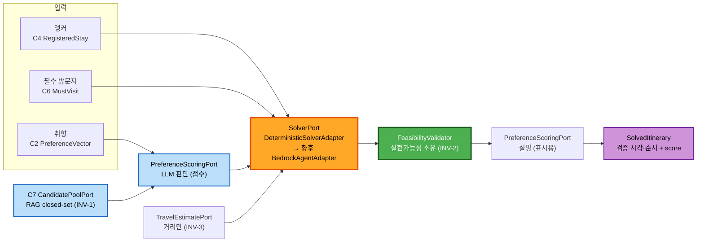

# Application Design — Component Dependency & Data Flow

> 규칙: 모듈 간 **다른 모듈의 `api`(facade·DTO·event)만 의존**. 동기 = public facade 호출, 비동기 = 도메인 이벤트(트랜잭셔널 아웃박스·at-least-once·멱등 구독). **순환 동기 의존 금지**(상태 전파는 이벤트로).

> **[개정 · 2026-10-12]** 모듈 내부 계층은 `api / application / domain / adapter(in·out)` 다(`infra/` 없음). 모듈 목록 정본은 `backend/settings.gradle.kts` — 이 문서에 없는 `:modules:moderation`(profile 이 의존)·`:modules:change-log` 가 있다.

---

## 1. 의존성 매트릭스 (동기 facade 호출: 행 → 열)

| 소비 \ 제공 | C1 Auth | C2 Prof | C3 Search | C4 Stay | C5 Aff | C6 Trip | C7 Place | C8 Gen | C9 Detect | C10 Recalc | C11 Ctx | C12 Arch | C13 Refl | C14 Notif |
|---|:-:|:-:|:-:|:-:|:-:|:-:|:-:|:-:|:-:|:-:|:-:|:-:|:-:|:-:|
| C3 Search | ● | ● | | | ● | | | | | | | | | |
| C4 Stay | ● | | ● | | ● | | | | | | | | | |
| C6 Trip | ● | ● | | ● | | | ● | | | | | | | |
| C8 Gen | | ● | | ● | | ● | ● | | | | | | | |
| C9 Detect | | | | ● | | | ● | | | | ● | ● | | |
| C10 Recalc | | ● | | ● | | | ● | | ● | | | | | |
| C13 Refl | | ● | | | | ● | | | | | | ● | | |
| C15 Community* | ● | ● | | ● | | ● | | ● | | | | ● | ● | |
| C16 Assistant* | | ● | ● | ● | | ● | ● | ● | | ● | | | ● | |
| C17 Collab* | ● | | | ● | | ● | | ● | | | | ● | | |

`*` = 후속 게이트(인터페이스만). **C14 Notification은 어떤 것도 동기 호출하지 않고 이벤트만 구독**(단방향, 순환 차단).

> **[개정 · 2026-10-12]** 실제 모듈 간 컴파일 의존(각 `backend/modules/*/build.gradle.kts` 의 `project(":modules:…")`) — accommodation-search→place-data · affiliate-link→accommodation-search · trip→place-data · saved-accommodation→trip·place-data · profile→moderation·auth · change-log→trip · itinerary-generation→change-log·trip·profile·saved-accommodation·place-data · itinerary-recalculation→trip·itinerary-generation·saved-accommodation·place-data·archive·auth · planb-detection→trip·itinerary-generation·weather-context · weather-context→place-data · archive→trip·auth·itinerary-generation·saved-accommodation·change-log · reflection→trip·archive·place-data·profile·auth·change-log(2026-10-22 TRIP-1463 — 그날 적용된 재계획을 회고 재료로 읽는다) · notification→trip·itinerary-generation. 위 매트릭스와 다른 점: C10→C8(`ReplanFacade`)이 있고 C10→C9 는 없다(C9 는 `api/` facade 없이 이벤트만), C14 도 동기 의존(trip·itinerary-generation)이 있다. **C15·C17 행은 폐기**, C16 은 개발 범위(U8)로 의존은 U8 설계에서 정한다(사용자 결정 2026-10-12).

**포트 소비(일정 지능)**: C8·C10 → `SolverPort`·`PreferenceScoringPort`·`CandidatePoolPort`(C7)·`TravelEstimatePort`. C13·C16 → `PreferenceScoringPort`(재사용).

> **[개정 · 2026-10-12]** C8 → `ScheduleAgentPort`(AI HTTP) 하나. C10 은 AI 포트를 직접 잡지 않고 C8 `ReplanFacade` 를 경유한다. C13 → `ReflectionAgentPort`(`/ai/v1/reflection/generate`), C14 → `HttpReminderCopyAdapter`(`/ai/v1/notification/copies`). `PreferenceScoringPort`·`CandidatePoolPort`·`TravelEstimatePort` 는 백엔드에 없다(AI 서비스 내부).

---

## 2. 도메인 이벤트 카탈로그 (비동기·아웃박스)

| 이벤트 | 발행 | 구독 | 용도 |
|---|---|---|---|
| `AccountCreated` | C1 | C2 | 프로필 초기화 |
| `AccountDeletionRequested` | C1 | C4·C6·C12·C15 | 삭제 캐스케이드 |
| `PreferencesUpdated` | C2 | C8·C13 | 재개인화 |
| `StayRegistered` | C4 | C6·C14 | 일정 생성 유도·알림 |
| `StayUpdated` | C4 | C8 | 재생성 여부 질의 |
| `TripCreated` | C6 | — | (기록) |
| `MustVisitChanged` | C6 | C8 | 해당 날짜 재계산 |
| `PlanBTriggered` | C9 | C14·C10 | 알림·재계획 제안 |
| `ItineraryChanged` | C8·C10 | C12 | change log 반영 |
| `VisitChecked` | C12 | C9 | 체류 초과 트리거 입력 |
| `TripEnded` | C12 | C13·C14 | 회고 생성·알림 |
| `ReflectionReady` | C13 | C14 | 회고 완료 알림 |
| `CommunityReaction`* | C15 | C14 | 좋아요·댓글 알림(묶기) |

> **[개정 · 2026-10-12]** 이벤트 카탈로그 현행 — 발행 정본 `backend/modules/*/src/main/kotlin/**/api/event/`, 구독 정본 `adapter/in/event/*Subscriber.kt`(`OutboxSubscriber`).
>
> | 이벤트(eventType) | 발행 | 구독 |
> |---|---|---|
> | `auth.AccountCreated` | auth | — |
> | `auth.AccountDeletionRequested` · `auth.AccountDeletionCancelled` | auth | — |
> | `auth.GpsRecordingOptOut` | auth | archive |
> | `auth.LocationLegalConsentRevoked` | auth | itinerary-recalculation |
> | `stay.StayRegistered` | saved-accommodation | notification |
> | `stay.TripBaseResolved` | saved-accommodation | — |
> | `trip.TripEnded` | trip | reflection |
> | `trip.TripDeleted` | trip | notification |
> | `itinerary.ItineraryGenerated` | itinerary-generation | notification |
> | `itinerary.ItineraryConfirmed` | itinerary-generation | — |
> | `planb.PlanBTriggered` | planb-detection | notification |
> | `recalculation.ItineraryRecalculated` | itinerary-recalculation | notification |
> | `archive.VisitChecked` | archive | — |
> | `reflection.ReflectionReady` | reflection | notification |
>
> 미발행(설계에만 있음): `PreferencesUpdated`·`StayUpdated`·`TripCreated`·`MustVisitChanged`·`ItineraryChanged`. `CommunityReaction` 은 C15 폐기로 소멸. change log 반영은 이벤트가 아니라 `ChangeLogFacade` 동기 호출(반영과 같은 트랜잭션, `itinerary-generation/api/ReplanFacade.kt` `apply`)이다.

> at-least-once → **멱등 구독**(예: Affiliate 포스트백·재고성 이벤트). 부작용은 이벤트 ID 기준 1회 적용.

> **[개정 · 2026-10-12]** Affiliate 포스트백 수신은 없다 — `affiliate_click.postback_status` 는 항상 `NONE`(`backend/app/src/main/resources/db/migration/V2.59__affiliate_click.sql`).

---

## 3. 데이터 흐름 — 솔버 파이프라인 (S2) ★


- **판단(파랑 SCORE)** ↔ **진실(초록 VALID)** 분리. **교체 지점 = 주황 SOLVE 어댑터만.** 사용자 노출값은 항상 VALID 통과분.

> **[개정 · 2026-10-12]** 다이어그램의 POOL·SCORE·DIST·SOLVE·VALID 는 전부 AI 서비스(`ai/`) 내부다 — 백엔드는 `ScheduleAgentPort.generate` 1회 호출. SOLVE 의 실제 구현은 `HybridAssemblyFacade`(OR-Tools → 규칙 폴백, `ai/src/trippilot/assembly_engine/facade.py`)이고 "향후 BedrockAgentAdapter" 교체 지점은 현행이 아니다. POOL 은 AI 가 백엔드 `/internal/pois` 를 읽어 만든다(`poi_curation/adapters/backend_poi_db.py`). EXPL 은 백엔드가 별도 `/ai/v1/itinerary/explanations` 로 받는다.

## 4. 데이터 흐름 — 사진 저장 (2026-07-12 결정)
```
촬영/선택 → C12 LocalPhotoAssetPort (기기 로컬 참조)
          → 서버: PhotoMetadata만 저장 (자산 ID·촬영 시각·EXIF 위치·연결 장소)
          → [커뮤니티 공개 선택 시만] EXIF GPS 제거 → ObjectStoragePort(S3) 업로드 → 타 사용자 열람
멀티 디바이스 미지원: 기기 변경 시 로컬 사진 유실 · 메타데이터만 잔존
```

> **[개정 · 2026-10-12]** 커뮤니티 공개 사진 S3 경로는 C15 폐기로 소멸 — 백엔드에 `ObjectStoragePort`/S3 어댑터가 없다.

## 5. 외부 어댑터 포트 (1 API = 1 포트/어댑터)
| 포트 | 소유 | 벤더(가정) | 약관·폴백 |
|---|---|---|---|
| `SocialOAuthPort` | C1 | 카카오·네이버·Google·Apple | 취소/장애 복구 |
| `MailPort` | C1 | (미정) | 재발송 |
| `AccommodationContentPort` | C3 | 글로벌 OTA·TourAPI | 정적 캐싱 허용 |
| `LivePricePort` | C3 | OTA | **가격 캐싱 금지** |
| `OtaDeeplinkPort` | C5 | OTA 제휴 | 포스트백 멱등·링크 실패 우회 |
| `MapPlacePort` | C7 | 카카오/네이버/TMap·Google | **영구 캐싱 금지·실시간·출처**, 실패 시 폴백 |
| `TravelEstimatePort` | C7/공용 | (거리 산출) | 직선거리 폴백 |
| `WeatherPort` | C11 | 공공데이터포털/OpenWeather | 실패 시 무발화 |
| `LlmGatewayPort` | 공용(C8·C13·C16) | AWS Bedrock(가정) | rate-limit·가드레일·권한 경계·결정론적 폴백 |
| `SolverPort` | C8·C10 | 별도 솔버 서비스(Python) | 결정론적 폴백(내장) |
| `PushPort`/`RealtimePort` | C14 | FCM/APNs·WS/SSE | catch-up |
| `ObjectStoragePort` | C12 | AWS S3 | 공개 사진만·EXIF 제거 |

> **[개정 · 2026-10-12]** 외부 포트 현행(경로는 `backend/modules/` 기준) — `MailPort` 없음(소셜 전용). C3 는 실시간 가격 어댑터 없이 `StayPriceQueryPort` ← 가격 스냅숏 영속 `StayPriceAdapter`(`accommodation-search/adapter/out/persistence/`). `OtaDeeplinkPort` → `TripcomDeeplinkAdapter`·`WebSearchFallbackAdapter`(포스트백 없음). `MapPlacePort` → 카카오 로컬(`KakaoPlaceLookupAdapter`·`KakaoRegionGeocodeAdapter`). `TravelEstimatePort` 는 AI 내부(`ai/src/trippilot/assembly_engine/travel.py`). `WeatherPort` → 기상청 `KmaWeatherAdapter`. `LlmGatewayPort` 는 백엔드에 없고 AI 서비스 `llm_gateway` 소유(LlmFeature 18종 전부 Claude `claude-fable-5-1`, provider `openai|anthropic|mixed` — 루트 `.env.example`; Bedrock 은 증류 모델 Custom Model Import·Titan 임베딩 선택 배선뿐). `SolverPort` → `ScheduleAgentPort`/`HttpScheduleAgentAdapter`(별도 솔버 서비스 없음, 상대는 AI 서비스 `ai/`). `PushPort`/`RealtimePort` → `ExpoPushAdapter`(WS/SSE 없음, 알림함 폴링). `ObjectStoragePort` 없음. 추가 경계: `ReflectionAgentPort`(`/ai/v1/reflection/generate`), `HttpReminderCopyAdapter`(`/ai/v1/notification/copies`).

> 모든 외부 포트는 **침묵 실패 금지(ADR-0011)** 폴백을 어댑터 경계에서 강제.

## 6. 순환 의존 방지
- 상태 전파(예: 등록→일정, 방문→트리거, 반응→알림)는 **이벤트**로 단방향. 동기 호출은 상위→하위(조회) 방향만. C14는 순수 구독자.
